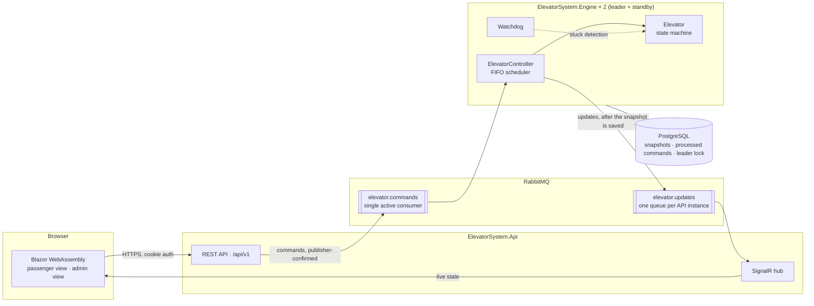
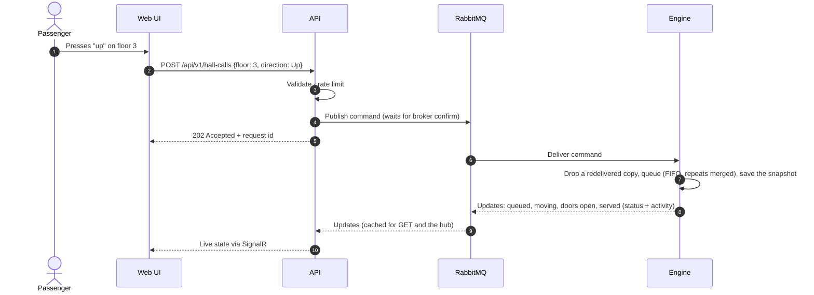
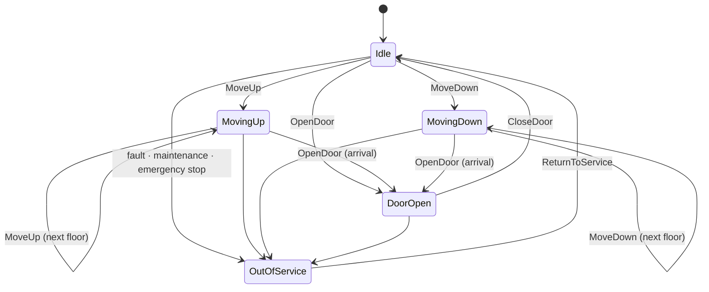

# ElevatorSystem

[](https://github.com/onlygreb/ElevatorSystem/actions/workflows/ci.yml)
[](https://github.com/onlygreb/ElevatorSystem/actions/workflows/codeql.yml)


An elevator control system built on .NET 10. It has:
- a thread-safe control core that handles concurrent passenger requests
- a message-driven engine that fails safe
- a REST and real-time API
- a Blazor web interface for passengers and operators

Security is part of the design from the first commit.

> **Project status:** the whole system runs end to end:
> - a thread-safe elevator core with FIFO and LOOK scheduling and a stuck-car watchdog
> - a REST and SignalR API, with RabbitMQ between the API and the engine and PostgreSQL for recovery
> - failover between two engines, staff sign-in with a second factor and a tamper-evident audit trail
> - a live web UI where you ride the elevator yourself, and admin demo scenarios
> - about 800 automated tests, including property-based, concurrency and end-to-end suites
>
> Observability, load and mutation testing are the current milestone. See the [roadmap](#roadmap).

---

## Contents

- [What it does](#what-it-does)
- [Requirements and where they are met](#requirements-and-where-they-are-met)
- [Architecture](#architecture)
- [Design highlights](#design-highlights)
- [Technology](#technology)
- [Getting started](#getting-started)
- [Repository layout](#repository-layout)
- [Quality and testing](#quality-and-testing)
- [Continuous integration and delivery](#continuous-integration-and-delivery)
- [Roadmap](#roadmap)
- [Documentation](#documentation)

---

## What it does

ElevatorSystem controls an elevator serving floors 1 to 10 and gives passengers and operators a live view of it.

| Capability | Description |
|---|---|
| **Passenger journeys** | Every passenger enters the building on floor 1, calls the car, walks in while its doors are open on their floor (a bar shows the 4 seconds left), chooses a floor and walks out when the doors open, or rides on. With nowhere to go, the car waits with its doors open. Invalid requests are refused with a reason. |
| **Scheduling** | First-in, first-out by default, with duplicate presses merged. A LOOK strategy can be switched on to compare average wait times. |
| **Real-time simulation** | Car movement and doors run in real time; every change streams live to connected browsers. |
| **Concurrency** | 100+ simultaneous requests handled safely; target time from request to assignment under 100 ms. |
| **Fail-safe operation** | Stuck-car detection, out-of-service mode, emergency stop, recovery after restart, and a guarantee that only one controller drives the car. |
| **Admin view** | People in the elevator, waiting and present on each floor, live status and activity; maintenance, emergency stop and return to service. Admins manage the service, they never operate the car. |
| **Demo scenarios** | Admins start a morning rush, a lunch break or a busy day and watch simulated passengers fill the floors and ride the car, in a living picture of the building. |
| **Privacy** | Passengers are anonymous by design: nothing identifies who rides the elevator. |
| **Languages** | English and Brazilian Portuguese. |

## Requirements and where they are met

Each core requirement maps to the code that implements it and the tests that prove it.

| Requirement | Implementation | Proven by |
|---|---|---|
| One elevator serving floors 1–10 | [`Building`](src/ElevatorSystem.Domain/Building.cs), [`Elevator`](src/ElevatorSystem.Domain/Elevator.cs) | `BuildingTests`, `ElevatorTransitionTests` |
| States `IDLE`, `MOVING_UP`, `MOVING_DOWN`, `DOOR_OPEN` | [`ElevatorState`](src/ElevatorSystem.Domain/ElevatorState.cs), plus `OUT_OF_SERVICE` for faults | All 20 state × command pairs in `ElevatorTransitionTests` |
| `moveUp()`, `moveDown()`, `openDoor()`, `closeDoor()`, `addRequest()` | `Elevator.MoveUp`, `MoveDown`, `OpenDoor`, `CloseDoor`, `AddRequest` | `ElevatorTransitionTests`, `ElevatorRequestTests` |
| `requestElevator(floor, direction)`, `processRequests()` | [`ElevatorController`](src/ElevatorSystem.Application/ElevatorController.cs)`.RequestElevator`, `ProcessRequests` (destinations: `RequestDestination`) | `ElevatorControllerRequestTests`, `ElevatorControllerJourneyTests` |
| Pickup (floor + direction) and destination requests | `HallCall`, `CarCall` | `ElevatorRequestTests`, `ElevatorControllerJourneyTests` |
| FIFO scheduling | [`FifoSchedulingStrategy`](src/ElevatorSystem.Domain/Scheduling/FifoSchedulingStrategy.cs) ([ADR-0005](docs/adr/0005-fifo-scheduling-semantics.md)) | `SchedulingPropertyTests` (1,000 random workloads), journey tests |
| Locks, thread-safe collections, atomic state changes, no races in assignment | `System.Threading.Lock` in `Elevator`; bounded `Channel<T>` intake with a single consumer; immutable snapshots ([ADR-0004](docs/adr/0004-concurrency-model-and-time-abstraction.md)) | `ElevatorConcurrencyTests`, `ElevatorControllerConcurrencyTests` |
| 100+ concurrent requests, assignment under 100 ms | Requests applied while the car travels ([ADR-0012](docs/adr/0012-elevator-control-loop.md)) | 2,000 simultaneous requests with the 99th percentile asserted under 100 ms |
| Reasonable memory under load | Repeated calls merged: at most 28 pending calls | `ElevatorRequestTests`, concurrency tests |
| Invalid floor requests handled gracefully | `Building.Validate` returns a `RequestRejectionReason` and never throws | `BuildingTests`, `ElevatorControllerRequestTests` |
| Timeouts for stuck elevators | Trip watchdog → out of service (`Fault`) ([ADR-0007](docs/adr/0007-fail-safe-operation.md)) | `ElevatorControllerFailSafeTests` |
| A stuck elevator stays out of service across restarts | The fault is saved in the snapshot and restored, with every call cancelled, until a return to service ([ADR-0021](docs/adr/0021-engine-hosting-topology-and-single-process-mode.md)) | `RestoredOutOfServiceCar_StaysOutOfService_WithItsDoorClosed` |
| Recovery after a crash or restart; one controller at a time | Snapshot in PostgreSQL, advisory-lock leader with a hot standby, commands kept in RabbitMQ until applied ([ADR-0019](docs/adr/0019-postgresql-snapshots-deduplication-and-leader-lease.md), [ADR-0021](docs/adr/0021-engine-hosting-topology-and-single-process-mode.md)) | `ElevatorEngineTests`, integration tests: killing the leader, restarting the only engine, broker outage, engine down |
| Exception handling for concurrent operations | Failures contained per request, per trip and per subscriber; the loop fails safe | `ElevatorControllerFailSafeTests` |
| Logging of elevator actions | Source-generated messages with stable event IDs ([`ElevatorControllerLog`](src/ElevatorSystem.Application/ElevatorControllerLog.cs)) | Console demo with `--verbose` |

## Architecture

The API accepts and validates requests, the engine drives the elevator, and RabbitMQ sits between
them, so each side can fail and restart without losing accepted work.



### Life of a request



### Elevator states



The car never moves with its doors open, never leaves the 1–10 range, and changes direction only after stopping.

## Design highlights

**Thread safety you can reason about.**
- Requests enter through a bounded channel: many writers, one reader.
- A single scheduler loop owns the queue.
- The car's state is changed only inside a lock, as atomic check-and-set transitions.
- Readers receive immutable snapshots.
- Safety commands skip the queue so they take effect immediately.
- See [ADR-0004](docs/adr/0004-concurrency-model-and-time-abstraction.md).

**FIFO, defined precisely.**
- Requests are served strictly in arrival order, and identical presses are merged.
- So the pending queue is bounded (at most 28 entries) however many requests arrive.
- See [ADR-0005](docs/adr/0005-fifo-scheduling-semantics.md).

**Fail-safe by design.**
- Safety rules live in the domain model itself.
- A watchdog takes a stuck car out of service.
- Broker or database outages degrade health instead of freezing the car.
- State is snapshotted for recovery.
- A database lock guarantees a single active controller.
- See [ADR-0007](docs/adr/0007-fail-safe-operation.md).

**Secure by default.**
- Same-origin cookie authentication (no tokens in the browser), with a second factor required for every staff role ([ADR-0022](docs/adr/0022-staff-authentication-and-authorization.md)).
- Deny-by-default authorization, rate limiting and strict security headers.
- A hash-chained audit trail, written before each staff action takes effect, that pinpoints any entry changed outside the application ([ADR-0023](docs/adr/0023-audit-trail-writer-and-verification.md)).
- A build that fails on any known-vulnerable dependency.
- See [SECURITY.md](SECURITY.md) and [ADR-0008](docs/adr/0008-dependency-and-supply-chain-policy.md).

**Private by design.**
- Passengers are anonymous: a passenger is a random ID kept by the browser.
- Staff credentials, keys and client addresses never reach the logs, and tests enforce it.
- Client addresses in the audit trail are keyed pseudonyms, and a staff member's entries can be
  anonymised without breaking the hash chain.

## Technology

| Area | Choice |
|---|---|
| Runtime | .NET 10 (LTS), C# 14 |
| API | ASP.NET Core Minimal APIs, SignalR, OpenAPI |
| UI | Blazor WebAssembly, MudBlazor, en-US / pt-BR localisation |
| Messaging | RabbitMQ (quorum queues) via RabbitMQ.Client |
| Persistence | PostgreSQL via Entity Framework Core |
| Orchestration | Aspire (local), SDK-built chiseled container images (delivery) |
| Observability | OpenTelemetry logs, traces and metrics, including the elevator's own: wait times, refusals, travel, interruptions and occupancy ([ADR-0028](docs/adr/0028-elevator-metrics.md)) |
| Testing | xUnit v3, Shouldly, CsCheck, bUnit, Playwright, Testcontainers, Verify, Stryker.NET, k6 |

## Getting started

**Prerequisites:** [.NET 10 SDK](https://dotnet.microsoft.com/download/dotnet/10.0) (10.0.100 or
later) and [Docker](https://www.docker.com/) (Docker Desktop or any engine the Docker CLI reaches) for
the full stack and the integration tests.

```bash
git clone https://github.com/onlygreb/ElevatorSystem.git
cd ElevatorSystem
dotnet build ElevatorSystem.slnx
dotnet test --solution ElevatorSystem.slnx
```

Run the whole system with the Aspire dashboard (logs, traces and metrics for every service):

```bash
dotnet run --project src/ElevatorSystem.AppHost
```

Aspire starts RabbitMQ (with its management UI), PostgreSQL, two engines (one leads, one stands by)
and the API. Open the `api` endpoint from the dashboard, enter the building and ride the elevator; stop the
leading `engine` replica in the dashboard and the standby takes over from the saved state. Passwords are
generated on the first run and kept in the AppHost's user secrets; nothing secret is in the repository.

To use the admin view, open `/admin` on the `api` endpoint and sign in as `admin@elevator.local` with the
`admin-password` parameter: the dashboard asks you to choose it on the first run and shows it in its Parameters
view (the account is created once, so keep the same password). The first sign-in asks you to register an authenticator app
(any TOTP app: scan the QR code), then shows one-time recovery codes. Every staff feature needs that second factor.
Then press a demo scenario and watch the building fill up.

Without Docker, the API alone runs the engine in its own process over in-memory messaging and storage
(`Hosting:Mode=SingleProcess`, the Development default; [ADR-0021](docs/adr/0021-engine-hosting-topology-and-single-process-mode.md)):

```bash
dotnet run --project src/ElevatorSystem.Api
```

In this mode staff accounts live in memory too: create one for the session with
`dotnet user-secrets` on the API project (`Staff:Accounts:0:Email`, `Staff:Accounts:0:Password`,
`Staff:Accounts:0:Role` = `Admin` or `Auditor`).

Run only the elevator core in the terminal, with no infrastructure. A narrated tour of about
15 seconds walks through each behaviour:
- a pickup and a destination
- FIFO order
- merged button presses
- invalid requests
- a burst of 200 simultaneous requests
- an emergency stop
- the stuck-car watchdog

```bash
dotnet run --project src/ElevatorSystem.ConsoleDemo
```

Or drive the elevator yourself (`call 5 up`, `go 3`, `stop`, `resume`, `jam`, `status`, `help`):

```bash
dotnet run --project src/ElevatorSystem.ConsoleDemo -- --interactive
```

## Repository layout

```
src/
  ElevatorSystem.Domain           Elevator state machine, requests, scheduling strategies
  ElevatorSystem.Contracts        HTTP and message contracts shared across processes
  ElevatorSystem.Application      ElevatorController, use cases, ports
  ElevatorSystem.Infrastructure   RabbitMQ, PostgreSQL, audit log, retention jobs
  ElevatorSystem.Engine           Host that runs the control loop
  ElevatorSystem.Api              REST API and SignalR hub; serves the web UI
  ElevatorSystem.Web              Blazor WebAssembly UI
  ElevatorSystem.ConsoleDemo      The elevator core, runnable without infrastructure
  ElevatorSystem.ServiceDefaults  Telemetry, health checks, resilience
  ElevatorSystem.AppHost          Local orchestration
tests/                            Test projects, one per layer
docs/adr/                         Architecture decision records
```

Dependencies point inwards. The domain and contracts reference nothing, and the web UI can see
only the contracts. An architecture test suite enforces these rules on every build
([ADR-0002](docs/adr/0002-layered-architecture-with-ports-and-adapters.md)).

## Quality and testing

The riskiest parts of an elevator controller are concurrency, timing and failure handling, so the
test strategy targets them directly ([ADR-0010](docs/adr/0010-testing-strategy.md)):

| Layer | What it proves |
|---|---|
| Architecture | Dependency direction and package policy hold |
| Domain | Every state transition; invariants over thousands of random request sequences (property-based) |
| Application | Behaviour in virtual time (no sleeps); no lost or duplicated requests under parallel load |
| API | Authorization matrix for every endpoint and role, validation, rate limits, security headers, contract snapshots |
| UI | Component behaviour, end-to-end flows and accessibility checks |
| Integration | Real RabbitMQ and PostgreSQL in containers, including outages, restarts and failover |
| Load | 100+ concurrent requests within the assignment-latency budget |
| Mutation testing | The tests actually detect injected faults |

The architecture, domain, application, API, UI component and integration suites run on every build
today; the integration tests start RabbitMQ and PostgreSQL in Docker and the engines as real processes.
Browser end-to-end, load and mutation testing arrive in phase 5. The unit tests run in simulated time
([`FakeTimeProvider`](https://learn.microsoft.com/dotnet/api/microsoft.extensions.time.testing.faketimeprovider)),
so the suite never sleeps and never flakes on timing.

Quality gates enforced by the build:
- warnings are errors
- code style is enforced
- non-deterministic time APIs are banned in production code
- builds are reproducible

## Continuous integration and delivery

| Workflow | Trigger | What it does |
|---|---|---|
| [CI](.github/workflows/ci.yml) | Push to `main`, pull requests | Locked restore with vulnerability audit, format check, Release build, tests with coverage; dependency review on pull requests |
| [CodeQL](.github/workflows/codeql.yml) | Push, pull requests, weekly | Security analysis of the C# code and of the workflows themselves |
| [Release](.github/workflows/release.yml) | Tag `vX.Y.Z` | Re-verifies, publishes the API and engine images to GitHub Container Registry with signed build provenance, creates the GitHub release |
| [Dependabot](.github/dependabot.yml) | Weekly | Grouped updates for NuGet packages and GitHub Actions |

Every published image can be traced back to the exact workflow run and commit:

```bash
gh attestation verify oci://ghcr.io/onlygreb/elevatorsystem-api:<version> --owner onlygreb
```

## Roadmap

- [x] **Foundation:** solution architecture, build and supply-chain policies, CI/CD, architecture decisions
- [x] **Elevator core:** state machine, FIFO and LOOK scheduling, thread-safe controller with watchdog, console demo, domain and controller test suites
- [x] **API and live UI:** REST API, SignalR, Blazor passenger view, English and Portuguese
- [x] **Messaging and resilience:** RabbitMQ, PostgreSQL, state recovery, failover, occupancy counting, test traffic generator
- [x] **Administration and security:** staff sign-in with a mandatory second factor, admin view with live occupancy and service control, tamper-evident audit trail
- [ ] **Passenger journeys and quality:** passengers who board and leave, admin demo scenarios, redesigned UI, observability, load, end-to-end and mutation testing

## Documentation

- [Architecture decision records](docs/adr/README.md): every structural decision with its context and trade-offs
- [Security policy](SECURITY.md): how to report a vulnerability and how the repository protects itself

Contributions follow [Conventional Commits](https://www.conventionalcommits.org/) and the
checklist in the [pull request template](.github/pull_request_template.md).
