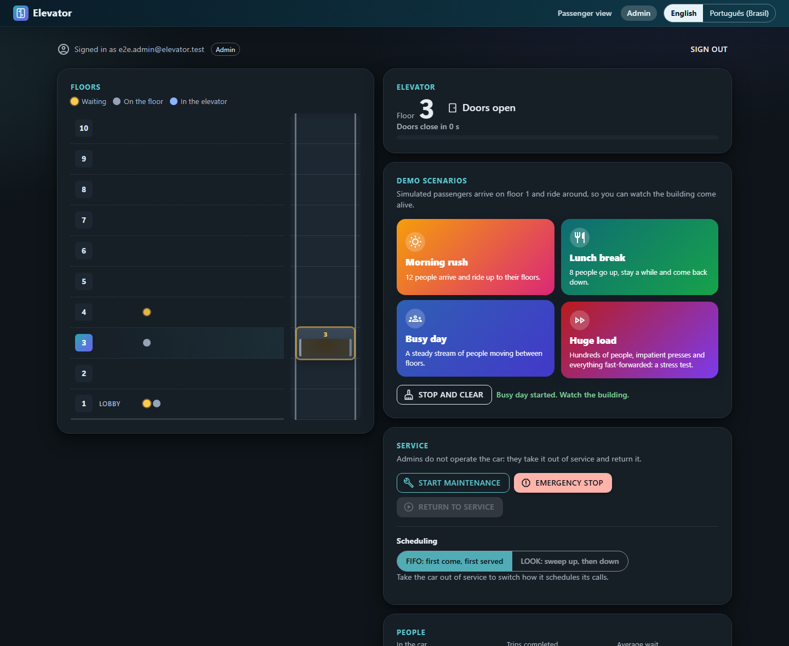
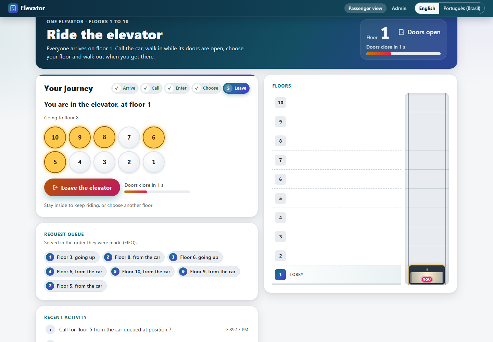
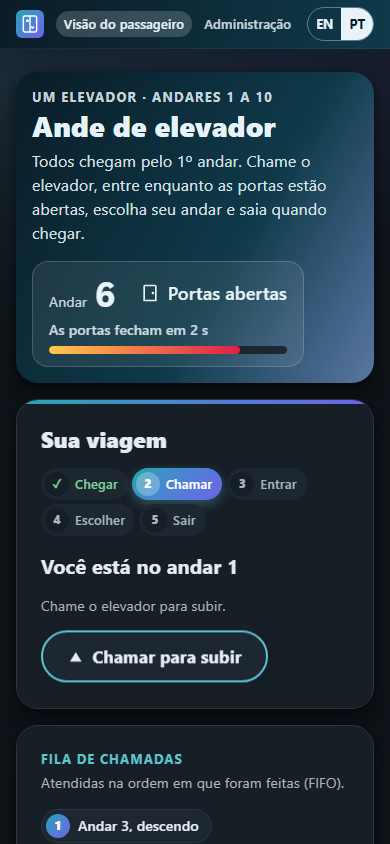
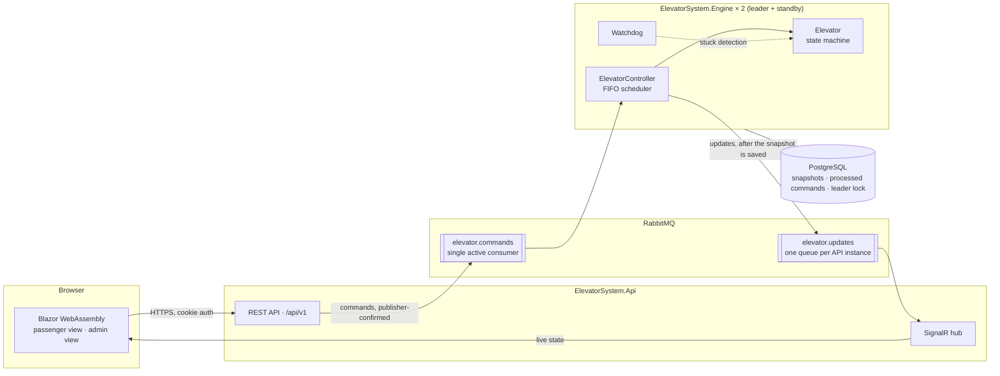
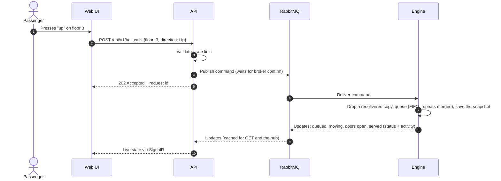
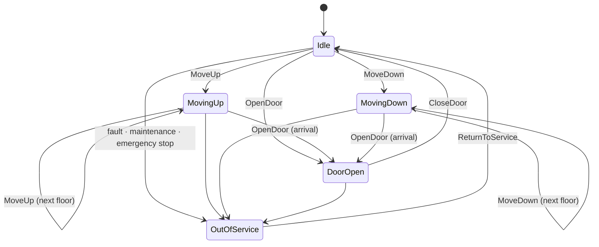

# ElevatorSystem

[](https://github.com/onlygreb/ElevatorSystem/actions/workflows/ci.yml)
[](https://github.com/onlygreb/ElevatorSystem/actions/workflows/codeql.yml)


An elevator control system built on .NET 10. It has:
- a thread-safe control core that handles concurrent passenger requests
- a message-driven engine that fails safe
- a REST and real-time API
- a Blazor web interface for passengers and operators

Security is part of the design from the first commit.

> **Project status:** the whole system runs end to end:
> - a thread-safe elevator core with FIFO and LOOK scheduling and a stuck-car watchdog
> - a REST and SignalR API, with RabbitMQ between the API and the engine and PostgreSQL for recovery
> - failover between two engines, staff sign-in with a second factor and a tamper-evident audit trail
> - a live web UI where you ride the elevator yourself, and admin demo scenarios
> - elevator metrics in OpenTelemetry: wait times, refusals, travel, interruptions and occupancy
> - over 850 automated tests, including property-based, concurrency, integration and browser suites, with
>   mutation testing and a load test run weekly
>
> Every phase of the [roadmap](#roadmap) is delivered.

---

## Contents

- [What it does](#what-it-does) and [screenshots](#screenshots)
- [Requirements and where they are met](#requirements-and-where-they-are-met)
- [Architecture](#architecture)
- [Design highlights](#design-highlights)
- [Technology](#technology)
- [Getting started](#getting-started)
- [Repository layout](#repository-layout)
- [Quality and testing](#quality-and-testing)
- [Continuous integration and delivery](#continuous-integration-and-delivery)
- [Roadmap](#roadmap)
- [Documentation](#documentation)

---

## What it does

ElevatorSystem controls an elevator serving floors 1 to 10 and gives passengers and operators a live view of it.

| Capability | Description |
|---|---|
| **Passenger journeys** | Every passenger enters the building on floor 1, calls the car, walks in while its doors are open on their floor (a bar counts down the last seconds, ending one second early so a late press still makes it), chooses a floor and walks out when the doors open, or rides on. With nowhere to go, the car waits with its doors open. Invalid requests are refused with a reason. |
| **Scheduling** | First-in, first-out by default, with duplicate presses merged. A LOOK strategy can be chosen in configuration (`Elevator:Scheduling`, or `ELEVATOR_SCHEDULING` in Docker Compose), or switched by an admin while the car is out of service, to compare average wait times, which the admin view shows with the strategy they were measured under ([ADR-0033](docs/adr/0033-admins-switch-scheduling-out-of-service.md)). |
| **Real-time simulation** | Car movement and doors run in real time; every change streams live to connected browsers. |
| **Concurrency** | 100+ simultaneous requests handled safely; target time from request to assignment under 100 ms. |
| **Fail-safe operation** | Stuck-car detection, out-of-service mode, emergency stop, recovery after restart, and a guarantee that only one controller drives the car. |
| **Admin view** | People in the elevator, waiting and present on each floor, live status and activity; maintenance, emergency stop and return to service. Admins manage the service, they never operate the car. |
| **Demo scenarios** | Admins start a morning rush, a lunch break or a busy day and watch simulated passengers fill the floors and ride the car, in a living picture of the building. **Stop and clear** sends the simulated people home, empties the queue and brings the car back to floor 1. A **huge load** stress-tests the whole system: 120 people, half of them pressing the call button again and again, with the car and the simulation fast-forwarded 8× ([ADR-0031](docs/adr/0031-huge-load-scenario-and-fast-forward.md)). |
| **Privacy** | Passengers are anonymous by design: nothing identifies who rides the elevator. |
| **Languages** | English and Brazilian Portuguese. |

### Screenshots

The admin dashboard during a busy day: simulated passengers wait, walk around and ride, while the admin watches
the car, starts demo scenarios and controls the service.



A passenger's journey: in the car at floor 1 with floor 8 chosen, the doors counting down, and the request queue
served in order. On a phone, in Brazilian Portuguese and the dark theme, the same journey starts in the lobby.

<p>
  
  
</p>

## Requirements and where they are met

Each core requirement maps to the code that implements it and the tests that prove it.

| Requirement | Implementation | Proven by |
|---|---|---|
| One elevator serving floors 1–10 | [`Building`](src/ElevatorSystem.Domain/Building.cs), [`Elevator`](src/ElevatorSystem.Domain/Elevator.cs) | `BuildingTests`, `ElevatorTransitionTests` |
| States `IDLE`, `MOVING_UP`, `MOVING_DOWN`, `DOOR_OPEN` | [`ElevatorState`](src/ElevatorSystem.Domain/ElevatorState.cs), plus `OUT_OF_SERVICE` for faults | All 20 state × command pairs in `ElevatorTransitionTests` |
| `moveUp()`, `moveDown()`, `openDoor()`, `closeDoor()`, `addRequest()` | `Elevator.MoveUp`, `MoveDown`, `OpenDoor`, `CloseDoor`, `AddRequest` | `ElevatorTransitionTests`, `ElevatorRequestTests` |
| `requestElevator(floor, direction)`, `processRequests()` | [`ElevatorController`](src/ElevatorSystem.Application/ElevatorController.cs)`.RequestElevator`, `ProcessRequests` (destinations: `RequestDestination`) | `ElevatorControllerRequestTests`, `ElevatorControllerJourneyTests` |
| Pickup (floor + direction) and destination requests | `HallCall`, `CarCall` | `ElevatorRequestTests`, `ElevatorControllerJourneyTests` |
| FIFO scheduling | [`FifoSchedulingStrategy`](src/ElevatorSystem.Domain/Scheduling/FifoSchedulingStrategy.cs) ([ADR-0005](docs/adr/0005-fifo-scheduling-semantics.md)) | `SchedulingPropertyTests` (1,000 random workloads), journey tests |
| Locks, thread-safe collections, atomic state changes, no races in assignment | `System.Threading.Lock` in `Elevator`; bounded `Channel<T>` intake with a single consumer; immutable snapshots ([ADR-0004](docs/adr/0004-concurrency-model-and-time-abstraction.md)) | `ElevatorConcurrencyTests`, `ElevatorControllerConcurrencyTests` |
| 100+ concurrent requests, assignment under 100 ms | Requests applied while the car travels ([ADR-0012](docs/adr/0012-elevator-control-loop.md)) | 2,000 simultaneous requests with the 99th percentile asserted under 100 ms (the test raises the intake to 4,000; at the default of 1,024 waiting requests a bigger burst is refused as busy, never blocked); end to end, the [k6 load test](tests/load/README.md) (200 at once, then 2,000 a second) with p95 acceptance under 100 ms |
| Reasonable memory under load | Repeated calls merged: at most 28 pending calls | `ElevatorRequestTests`, concurrency tests |
| Invalid floor requests handled gracefully | `Building.Validate` returns a `RequestRejectionReason` instead of throwing | `BuildingTests`, `ElevatorControllerRequestTests` |
| Timeouts for stuck elevators | Trip watchdog → out of service (`Fault`) ([ADR-0007](docs/adr/0007-fail-safe-operation.md)) | `ElevatorControllerFailSafeTests` |
| A stuck elevator stays out of service across restarts | The fault is saved in the snapshot and restored, with every call cancelled, until a return to service ([ADR-0021](docs/adr/0021-engine-hosting-topology-and-single-process-mode.md)) | `RestoredOutOfServiceCar_StaysOutOfService_WithItsDoorClosed` |
| Recovery after a crash or restart; one controller at a time | Snapshot in PostgreSQL, advisory-lock leader with a hot standby, commands kept in RabbitMQ until applied ([ADR-0019](docs/adr/0019-postgresql-snapshots-deduplication-and-leader-lease.md), [ADR-0021](docs/adr/0021-engine-hosting-topology-and-single-process-mode.md)) | `ElevatorEngineTests`, integration tests: killing the leader, restarting the only engine, broker outage, engine down |
| Exception handling for concurrent operations | Failures contained per trip and per subscriber; any other failure in the control loop takes the car out of service instead of crashing it; a request that fails to apply is logged and dropped | `ElevatorControllerFailSafeTests`: a jammed car, a failing or throwing drive, failing subscribers, a broken scheduler |
| Logging of elevator actions | Source-generated messages with stable event IDs ([`ElevatorControllerLog`](src/ElevatorSystem.Application/ElevatorControllerLog.cs)) | Console demo with `--verbose` |

## Architecture

The API accepts and validates requests, the engine drives the elevator, and RabbitMQ sits between
them, so each side can fail and restart without losing accepted work.



### Life of a request



### Elevator states



The car never moves with its doors open, never leaves the 1–10 range, and changes direction only after stopping.

## Design highlights

**Thread safety you can reason about.**
- Requests enter through a bounded channel: many writers, one reader.
- A single scheduler loop owns the queue.
- The car's state is changed only inside a lock, as atomic check-and-set transitions.
- Readers receive immutable snapshots.
- Safety commands skip the queue so they take effect immediately.
- See [ADR-0004](docs/adr/0004-concurrency-model-and-time-abstraction.md).

**FIFO, defined precisely.**
- Requests are served strictly in arrival order, and identical presses are merged.
- So the pending queue is bounded (at most 28 entries) however many requests arrive.
- See [ADR-0005](docs/adr/0005-fifo-scheduling-semantics.md).

**Fail-safe by design.**
- Safety rules live in the domain model itself.
- A watchdog takes a stuck car out of service.
- Broker or database outages degrade health instead of freezing the car.
- State is snapshotted for recovery.
- A database lock guarantees a single active controller.
- See [ADR-0007](docs/adr/0007-fail-safe-operation.md).

**Secure by default.**
- Same-origin cookie authentication (no tokens in the browser), with a second factor required for every staff role ([ADR-0022](docs/adr/0022-staff-authentication-and-authorization.md)).
- Deny-by-default authorization, rate limiting and strict security headers.
- A hash-chained audit trail, written before each staff action takes effect, that pinpoints any entry changed outside the application ([ADR-0023](docs/adr/0023-audit-trail-writer-and-verification.md)).
- A build that fails on any known-vulnerable dependency.
- See [SECURITY.md](SECURITY.md) and [ADR-0008](docs/adr/0008-dependency-and-supply-chain-policy.md).

**Private by design.**
- Passengers are anonymous: a passenger is a random ID kept by the browser.
- Staff credentials, keys and client addresses never reach the logs, and tests enforce it.
- Client addresses in the audit trail are keyed pseudonyms, and a staff member's entries can be
  anonymised without breaking the hash chain.

## Technology

| Area | Choice |
|---|---|
| Runtime | .NET 10 (LTS), C# 14 |
| API | ASP.NET Core Minimal APIs, SignalR, OpenAPI |
| UI | Blazor WebAssembly, MudBlazor, en-US / pt-BR localisation |
| Messaging | RabbitMQ (quorum queues) via RabbitMQ.Client |
| Persistence | PostgreSQL via Entity Framework Core |
| Orchestration | Aspire (local), SDK-built chiseled container images (delivery) |
| Observability | OpenTelemetry logs, traces and metrics, including the elevator's own: wait times, refusals, travel, interruptions and occupancy ([ADR-0028](docs/adr/0028-elevator-metrics.md)) |
| Testing | xUnit v3, Shouldly, CsCheck, bUnit, Playwright, Testcontainers, Verify, Stryker.NET, k6 |

## Getting started

### 1. Choose how to run it

| You have | Run it with | You get |
|---|---|---|
| Docker only | **A. Docker Compose** (one command, nothing to set up) | The whole system as it would be deployed: broker, database, two engines, API and web UI over HTTPS, telemetry dashboard |
| .NET 10 SDK and Docker | **B. Aspire** (the development path) | The same system, with secrets generated for you and the Aspire dashboard opened for you |
| .NET 10 SDK only | **C. The API alone** | The web UI and the elevator in one process, in memory; nothing survives a restart |
| .NET 10 SDK only | **D. The console demo** | Only the elevator core, in the terminal |

Prerequisites, as needed: [Docker](https://www.docker.com/) (Docker Desktop or any engine the Docker CLI reaches)
and the [.NET 10 SDK](https://dotnet.microsoft.com/download/dotnet/10.0) (10.0.100 or later). Then get the code:

```bash
git clone https://github.com/onlygreb/ElevatorSystem.git
```

```bash
cd ElevatorSystem
```

### 2A. Docker Compose

Nothing to set up first ([ADR-0034](docs/adr/0034-docker-compose-starts-with-no-setup.md)). From the repository root,
build and start everything (the first build takes a few minutes):

```bash
docker compose -f deploy/compose.yaml up --build --detach
```

Then open https://localhost:8443. The API made itself a self-signed certificate on first start, so the browser warns
once: choose to continue (in Chrome and Edge, **Advanced**, then **Proceed to localhost**). Sign in to `/admin` as the
test admin (see [Use it](#3-use-it)). The dashboard is at http://localhost:18888 and RabbitMQ's management UI at
http://localhost:15672 (user `elevator`, password `elevator-local-broker`).

Every setting has a local default, and the defaults are public, so the API listens on this machine only. To use your
own passwords, your own certificate, a real admin or another scheduling strategy, copy
[`deploy/.env.example`](deploy/.env.example) to `deploy/.env` (git-ignored) and change what you need; it explains each
value, and [`deploy/README.md`](deploy/README.md) shows how to use the .NET development certificate, which browsers
trust without a warning.

To stop, run `docker compose -f deploy/compose.yaml down`. The data volumes are kept; add `--volumes` to start over
([ADR-0029](docs/adr/0029-docker-compose-and-dockerfile.md)).

### 2B. Aspire

1. Check that everything builds and the tests pass (the integration tests need Docker running):
   ```bash
   dotnet build ElevatorSystem.slnx
   ```
   ```bash
   dotnet test --solution ElevatorSystem.slnx
   ```
2. Start the system:
   ```bash
   dotnet run --project src/ElevatorSystem.AppHost
   ```
3. The terminal prints the dashboard's address. On the first run the dashboard asks for the `admin-password`
   parameter: choose one (at least 12 characters) and keep it, since the account is created once. The other
   passwords are generated and kept in the AppHost's user secrets; nothing secret is in the repository.
4. Open the `api` endpoint from the dashboard.

Press Ctrl+C in the terminal to stop. The database and broker volumes keep the car's floor and the staff accounts.

### 2C. The API alone

1. Trust the .NET development certificate once, so the browser accepts https://localhost (staff sign-in needs HTTPS):
   ```bash
   dotnet dev-certs https --trust
   ```
2. Start the API:
   ```bash
   dotnet run --project src/ElevatorSystem.Api
   ```
3. Open https://localhost:7104 (http://localhost:5251 redirects there).

The engine runs inside the API over in-memory messaging and storage (`Hosting:Mode=SingleProcess`, the
Development default; [ADR-0021](docs/adr/0021-engine-hosting-topology-and-single-process-mode.md)). Staff accounts
live in memory too. The test admin below is ready; for a real one, use `dotnet user-secrets` on the API project
(`Staff:Accounts:0:Email`, `Staff:Accounts:0:Password`, `Staff:Accounts:0:Role` = `Admin` or `Auditor`).

### 2D. The console demo

A narrated tour of about 15 seconds walks through each behaviour of the core:
- a pickup and a destination
- FIFO order
- merged button presses
- invalid requests
- a burst of 200 simultaneous requests
- an emergency stop
- the stuck-car watchdog

```bash
dotnet run --project src/ElevatorSystem.ConsoleDemo
```

Or drive the elevator yourself (`call 5 up`, `go 3`, `stop`, `resume`, `jam`, `status`, `help`):

```bash
dotnet run --project src/ElevatorSystem.ConsoleDemo -- --interactive
```

### 3. Use it

- **Ride the elevator.** On the home page, enter the building (everyone starts on floor 1), call the car,
  walk in while its doors are open, choose a floor, and walk out when the doors open there, or ride on.
- **Administer it.** Open `/admin`. To look around quickly, sign in as the **test admin**: e-mail
  `tester@elevator.local`, password `elevator-test-account`. It needs no authenticator app, and the page says it is a
  test account. The password is public, so turn the account off wherever others can reach the system: an empty
  `TEST_ADMIN_PASSWORD` in `deploy/.env`, or an empty `test-admin-password` parameter in Aspire
  ([ADR-0030](docs/adr/0030-test-account-without-second-factor.md)). A real admin (`admin@elevator.local` unless you
  change it; with Docker Compose, created once you set `ADMIN_PASSWORD`) registers an authenticator app at the first
  sign-in (any TOTP app: scan the QR code), then gets one-time recovery codes; every real staff account needs that
  second factor.
- **Watch it run.** Start a demo scenario and watch the building fill up, start a huge load to see the whole system under
  stress, fast-forwarded, or take the car out of service and return it.
- **See failover** (A and B). Two engines run: one drives the car, the other stands by. Stop the one that leads
  (`docker compose -f deploy/compose.yaml stop <container>`, or stop the replica in the Aspire dashboard) and the
  standby takes over from the last saved state within seconds.

## Repository layout

```
src/
  ElevatorSystem.Domain           Elevator state machine, requests, scheduling strategies
  ElevatorSystem.Contracts        HTTP and message contracts shared across processes
  ElevatorSystem.Application      ElevatorController, use cases, ports
  ElevatorSystem.Infrastructure   RabbitMQ, PostgreSQL, audit log, retention jobs
  ElevatorSystem.Engine           Host that runs the control loop
  ElevatorSystem.Api              REST API and SignalR hub; serves the web UI
  ElevatorSystem.Web              Blazor WebAssembly UI
  ElevatorSystem.ConsoleDemo      The elevator core, runnable without infrastructure
  ElevatorSystem.ServiceDefaults  Telemetry, health checks, resilience
  ElevatorSystem.AppHost          Local orchestration
tests/                            Test projects, one per layer
docs/adr/                         Architecture decision records
```

Dependencies point inwards. The domain and contracts reference nothing, and the web UI can see
only the contracts. An architecture test suite enforces these rules on every build
([ADR-0002](docs/adr/0002-layered-architecture-with-ports-and-adapters.md)).

## Quality and testing

The riskiest parts of an elevator controller are concurrency, timing and failure handling, so the
test strategy targets them directly ([ADR-0010](docs/adr/0010-testing-strategy.md)):

| Layer | What it proves |
|---|---|
| Architecture | Dependency direction and package policy hold |
| Domain | Every state transition; invariants over thousands of random request sequences (property-based) |
| Application | Behaviour in virtual time (no sleeps); no lost or duplicated requests under parallel load |
| API | Authorization matrix for every endpoint and role, validation, rate limits, security headers, contract snapshots |
| UI | Component behaviour; the passenger journey and the admin's demo in a real browser; WCAG 2.2 AA checks with axe |
| Integration | Real RabbitMQ and PostgreSQL in containers, including outages, restarts and failover |
| Load | 200 simultaneous presses, then 2,000 a second, with p95 acceptance under 100 ms and no request refused as busy ([k6](tests/load/README.md)) |
| Mutation testing | The tests detect injected faults: Domain 96%, Application core 82% (Stryker.NET, gate 80%) |

Every build runs the architecture, domain, application, API, UI component, integration and browser suites.
The integration tests start RabbitMQ and PostgreSQL in Docker and the engines as real processes; the browser
tests start the API as a process and drive it in Chromium with Playwright. Mutation testing and the load test
take too long for every pull request, so the Quality workflow runs them weekly and on demand. The behaviour tests
run in simulated time
([`FakeTimeProvider`](https://learn.microsoft.com/dotnet/api/microsoft.extensions.time.testing.faketimeprovider)),
so they never sleep and never depend on timing. The concurrency tests use the real clock on purpose: they measure
assignment latency with real threads.

The [screenshots](#screenshots) come from the browser suite too. To refresh them, point `ELEVATOR_SCREENSHOTS`
at the images folder (an absolute path) and run it:

```bash
ELEVATOR_SCREENSHOTS="$PWD/docs/images" dotnet test --project tests/ElevatorSystem.E2E.Tests -- --filter-class "*ReadmeScreenshots"
```

Quality gates enforced by the build:
- warnings are errors
- code style is enforced
- non-deterministic time APIs are banned in production code
- builds are reproducible

## Continuous integration and delivery

| Workflow | Trigger | What it does |
|---|---|---|
| [CI](.github/workflows/ci.yml) | Push to `main`, pull requests | Locked restore with vulnerability audit, format check, Release build, tests with coverage, browser tests; builds the Compose images from `deploy/Dockerfile`; dependency review on pull requests |
| [CodeQL](.github/workflows/codeql.yml) | Push, pull requests, weekly | Security analysis of the C# code and of the workflows themselves |
| [Quality](.github/workflows/quality.yml) | Weekly, on demand | Mutation testing of Domain and the Application core (fails below 80%) and the k6 load test |
| [Release](.github/workflows/release.yml) | Tag `vX.Y.Z` | Re-verifies, publishes the API and engine images to GitHub Container Registry with signed build provenance, creates the GitHub release |
| [Dependabot](.github/dependabot.yml) | Weekly | Grouped updates for NuGet packages and GitHub Actions |

Every published image can be traced back to the exact workflow run and commit:

```bash
gh attestation verify oci://ghcr.io/onlygreb/elevatorsystem-api:<version> --owner onlygreb
```

## Roadmap

- [x] **Foundation:** solution architecture, build and supply-chain policies, CI/CD, architecture decisions
- [x] **Elevator core:** state machine, FIFO and LOOK scheduling, thread-safe controller with watchdog, console demo, domain and controller test suites
- [x] **API and live UI:** REST API, SignalR, Blazor passenger view, English and Portuguese
- [x] **Messaging and resilience:** RabbitMQ, PostgreSQL, state recovery, failover, occupancy counting, test traffic generator
- [x] **Administration and security:** staff sign-in with a mandatory second factor, admin view with live occupancy and service control, tamper-evident audit trail
- [x] **Passenger journeys and quality:** passengers who board and leave, admin demo scenarios, redesigned UI, observability, load, end-to-end and mutation testing

## Documentation

- [Architecture decision records](docs/adr/README.md): every structural decision with its context and trade-offs
- [Security policy](SECURITY.md): how to report a vulnerability and how the repository protects itself

Contributions follow [Conventional Commits](https://www.conventionalcommits.org/) and the
checklist in the [pull request template](.github/pull_request_template.md).
