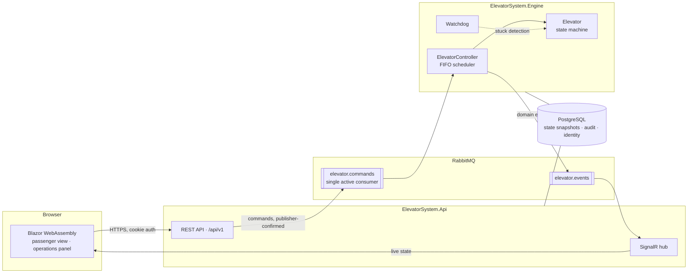
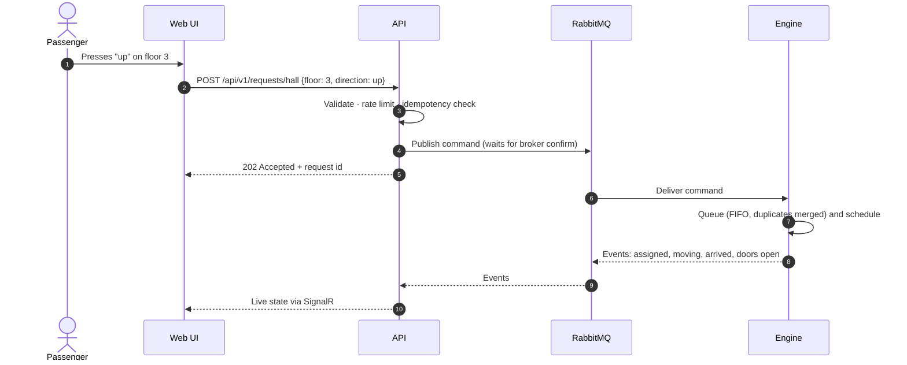
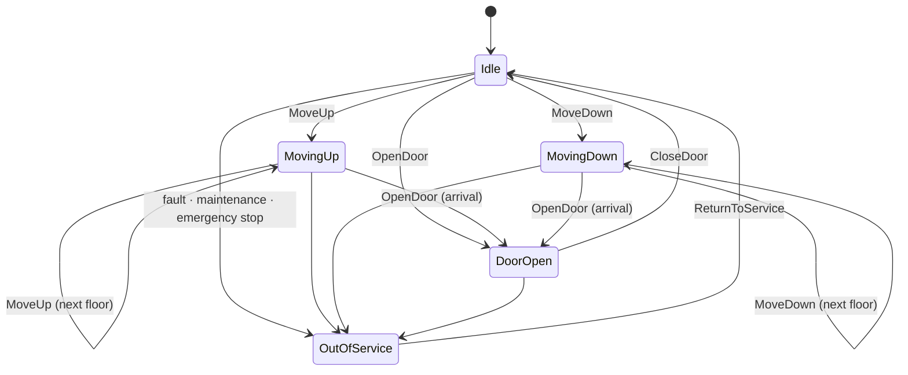

# ElevatorSystem

[](https://github.com/onlygreb/ElevatorSystem/actions/workflows/ci.yml)
[](https://github.com/onlygreb/ElevatorSystem/actions/workflows/codeql.yml)


An elevator control system built on .NET 10. It has:
- a thread-safe control core that handles concurrent passenger requests
- a message-driven engine that fails safe
- a REST and real-time API
- a Blazor web interface for passengers and operators

Security and LGPD compliance are part of the design from the first commit.

> **Project status:** the elevator core works end to end and runs from the console demo:
> - a thread-safe state machine
> - FIFO and LOOK scheduling
> - a controller with a stuck-car watchdog and safety commands
> - 164 automated tests, including property-based and concurrency suites
>
> The API and live web UI are the current milestone. See the [roadmap](#roadmap).

---

## Contents

- [What it does](#what-it-does)
- [Requirements and where they are met](#requirements-and-where-they-are-met)
- [Architecture](#architecture)
- [Design highlights](#design-highlights)
- [Technology](#technology)
- [Getting started](#getting-started)
- [Repository layout](#repository-layout)
- [Quality and testing](#quality-and-testing)
- [Continuous integration and delivery](#continuous-integration-and-delivery)
- [Roadmap](#roadmap)
- [Documentation](#documentation)

---

## What it does

ElevatorSystem controls an elevator serving floors 1 to 10 and gives passengers and operators a live view of it.

| Capability | Description |
|---|---|
| **Passenger requests** | Pickup calls from a floor (with direction) and destination calls from inside the car. Invalid floors are rejected gracefully. |
| **Scheduling** | First-in, first-out by default, with duplicate presses merged. A LOOK strategy can be switched on to compare average wait times. |
| **Real-time simulation** | Car movement and doors run in real time; every change streams live to connected browsers. |
| **Concurrency** | 100+ simultaneous requests handled safely; target time from request to assignment under 100 ms. |
| **Fail-safe operation** | Stuck-car detection, out-of-service mode, emergency stop, recovery after restart, and a guarantee that only one controller drives the car. |
| **Operations panel** | Live metrics, maintenance mode, emergency stop, strategy switch, tamper-evident audit log, user and role management. |
| **Privacy** | Passengers are anonymous by design; staff data follows LGPD purpose, retention and data-subject-rights rules. |
| **Languages** | English and Brazilian Portuguese. |

## Requirements and where they are met

Each core requirement maps to the code that implements it and the tests that prove it.

| Requirement | Implementation | Proven by |
|---|---|---|
| One elevator serving floors 1–10 | [`Building`](src/ElevatorSystem.Domain/Building.cs), [`Elevator`](src/ElevatorSystem.Domain/Elevator.cs) | `BuildingTests`, `ElevatorTransitionTests` |
| States `IDLE`, `MOVING_UP`, `MOVING_DOWN`, `DOOR_OPEN` | [`ElevatorState`](src/ElevatorSystem.Domain/ElevatorState.cs), plus `OUT_OF_SERVICE` for faults | All 20 state × command pairs in `ElevatorTransitionTests` |
| `moveUp()`, `moveDown()`, `openDoor()`, `closeDoor()`, `addRequest()` | `Elevator.MoveUp`, `MoveDown`, `OpenDoor`, `CloseDoor`, `AddRequest` | `ElevatorTransitionTests`, `ElevatorRequestTests` |
| `requestElevator(floor, direction)`, `processRequests()` | [`ElevatorController`](src/ElevatorSystem.Application/ElevatorController.cs)`.RequestElevator`, `ProcessRequests` (destinations: `RequestDestination`) | `ElevatorControllerRequestTests`, `ElevatorControllerJourneyTests` |
| Pickup (floor + direction) and destination requests | `HallCall`, `CarCall` | `ElevatorRequestTests`, `ElevatorControllerJourneyTests` |
| FIFO scheduling | [`FifoSchedulingStrategy`](src/ElevatorSystem.Domain/Scheduling/FifoSchedulingStrategy.cs) ([ADR-0005](docs/adr/0005-fifo-scheduling-semantics.md)) | `SchedulingPropertyTests` (1,000 random workloads), journey tests |
| Locks, thread-safe collections, atomic state changes, no races in assignment | `System.Threading.Lock` in `Elevator`; bounded `Channel<T>` intake with a single consumer; immutable snapshots ([ADR-0004](docs/adr/0004-concurrency-model-and-time-abstraction.md)) | `ElevatorConcurrencyTests`, `ElevatorControllerConcurrencyTests` |
| 100+ concurrent requests, assignment under 100 ms | Requests applied while the car travels ([ADR-0012](docs/adr/0012-elevator-control-loop.md)) | 2,000 simultaneous requests with the 99th percentile asserted under 100 ms |
| Reasonable memory under load | Repeated calls merged: at most 28 pending calls | `ElevatorRequestTests`, concurrency tests |
| Invalid floor requests handled gracefully | `Building.Validate` returns a `RequestRejectionReason` and never throws | `BuildingTests`, `ElevatorControllerRequestTests` |
| Timeouts for stuck elevators | Trip watchdog → out of service (`Fault`) ([ADR-0007](docs/adr/0007-fail-safe-operation.md)) | `ElevatorControllerFailSafeTests` |
| Exception handling for concurrent operations | Failures contained per request, per trip and per subscriber; the loop fails safe | `ElevatorControllerFailSafeTests` |
| Logging of elevator actions | Source-generated messages with stable event IDs ([`ElevatorControllerLog`](src/ElevatorSystem.Application/ElevatorControllerLog.cs)) | Console demo with `--verbose` |

## Architecture

The API accepts and validates requests, the engine drives the elevator, and RabbitMQ sits between
them, so each side can fail and restart without losing accepted work.



### Life of a request



### Elevator states



The car never moves with its doors open, never leaves the 1–10 range, and changes direction only after stopping.

## Design highlights

**Thread safety you can reason about.**
- Requests enter through a bounded channel: many writers, one reader.
- A single scheduler loop owns the queue.
- The car's state is changed only inside a lock, as atomic check-and-set transitions.
- Readers receive immutable snapshots.
- Safety commands skip the queue so they take effect immediately.
- See [ADR-0004](docs/adr/0004-concurrency-model-and-time-abstraction.md).

**FIFO, defined precisely.**
- Requests are served strictly in arrival order, and identical presses are merged.
- So the pending queue is bounded (at most 28 entries) however many requests arrive.
- See [ADR-0005](docs/adr/0005-fifo-scheduling-semantics.md).

**Fail-safe by design.**
- Safety rules live in the domain model itself.
- A watchdog takes a stuck car out of service.
- Broker or database outages degrade health instead of freezing the car.
- State is snapshotted for recovery.
- A database lock guarantees a single active controller.
- See [ADR-0007](docs/adr/0007-fail-safe-operation.md).

**Secure by default.**
- Same-origin cookie authentication (no tokens in the browser), two-factor auth for administrators.
- Deny-by-default authorization, rate limiting and strict security headers.
- A hash-chained audit log.
- A build that fails on any known-vulnerable dependency.
- See [SECURITY.md](SECURITY.md) and [ADR-0008](docs/adr/0008-dependency-and-supply-chain-policy.md).

**Private by design (LGPD).**
- Passenger requests carry no personal data at all.
- Staff data has a documented purpose, legal basis and retention period.
- Logs are redacted automatically.
- Staff can export or delete their own data.
- See [ADR-0009](docs/adr/0009-privacy-by-design-for-lgpd.md).

## Technology

| Area | Choice |
|---|---|
| Runtime | .NET 10 (LTS), C# 14 |
| API | ASP.NET Core Minimal APIs, SignalR, OpenAPI |
| UI | Blazor WebAssembly, MudBlazor, en-US / pt-BR localisation |
| Messaging | RabbitMQ (quorum queues) via RabbitMQ.Client |
| Persistence | PostgreSQL via Entity Framework Core |
| Orchestration | Aspire (local), SDK-built chiseled container images (delivery) |
| Observability | OpenTelemetry logs, traces and metrics |
| Testing | xUnit v3, Shouldly, CsCheck, bUnit, Playwright, Testcontainers, Verify, Stryker.NET, k6 |

## Getting started

**Prerequisites:** [.NET 10 SDK](https://dotnet.microsoft.com/download/dotnet/10.0) (10.0.100 or
later). [Docker](https://www.docker.com/) is needed for the full stack once the broker and
database are added.

```bash
git clone https://github.com/onlygreb/ElevatorSystem.git
cd ElevatorSystem
dotnet build ElevatorSystem.slnx
dotnet test --solution ElevatorSystem.slnx
```

Run the whole system with the Aspire dashboard (logs, traces and metrics for every service):

```bash
dotnet run --project src/ElevatorSystem.AppHost
```

Run only the elevator core in the terminal, with no infrastructure. A narrated tour of about
15 seconds walks through each behaviour:
- a pickup and a destination
- FIFO order
- merged button presses
- invalid requests
- a burst of 200 simultaneous requests
- an emergency stop
- the stuck-car watchdog

```bash
dotnet run --project src/ElevatorSystem.ConsoleDemo
```

Or drive the elevator yourself (`call 5 up`, `go 3`, `stop`, `resume`, `jam`, `status`, `help`):

```bash
dotnet run --project src/ElevatorSystem.ConsoleDemo -- --interactive
```

## Repository layout

```
src/
  ElevatorSystem.Domain           Elevator state machine, requests, scheduling strategies
  ElevatorSystem.Contracts        HTTP and message contracts shared across processes
  ElevatorSystem.Application      ElevatorController, use cases, ports
  ElevatorSystem.Infrastructure   RabbitMQ, PostgreSQL, audit log, retention jobs
  ElevatorSystem.Engine           Host that runs the control loop
  ElevatorSystem.Api              REST API and SignalR hub; serves the web UI
  ElevatorSystem.Web              Blazor WebAssembly UI
  ElevatorSystem.ConsoleDemo      The elevator core, runnable without infrastructure
  ElevatorSystem.ServiceDefaults  Telemetry, health checks, resilience
  ElevatorSystem.AppHost          Local orchestration
tests/                            Test projects, one per layer
docs/adr/                         Architecture decision records
```

Dependencies point inwards. The domain and contracts reference nothing, and the web UI can see
only the contracts. An architecture test suite enforces these rules on every build
([ADR-0002](docs/adr/0002-layered-architecture-with-ports-and-adapters.md)).

## Quality and testing

The riskiest parts of an elevator controller are concurrency, timing and failure handling, so the
test strategy targets them directly ([ADR-0010](docs/adr/0010-testing-strategy.md)):

| Layer | What it proves |
|---|---|
| Architecture | Dependency direction and package policy hold |
| Domain | Every state transition; invariants over thousands of random request sequences (property-based) |
| Application | Behaviour in virtual time (no sleeps); no lost or duplicated requests under parallel load |
| API | Authorization matrix for every endpoint and role, validation, rate limits, security headers, contract snapshots |
| UI | Component behaviour, end-to-end flows and accessibility checks |
| Integration | Real RabbitMQ and PostgreSQL in containers, including outages, restarts and failover |
| Load | 100+ concurrent requests within the assignment-latency budget |
| Mutation testing | The tests actually detect injected faults |

The architecture, domain and application suites run on every build today. Each remaining layer
arrives with the feature it covers. The unit tests run in simulated time
([`FakeTimeProvider`](https://learn.microsoft.com/dotnet/api/microsoft.extensions.time.testing.faketimeprovider)),
so the suite never sleeps and never flakes on timing.

Quality gates enforced by the build:
- warnings are errors
- code style is enforced
- non-deterministic time APIs are banned in production code
- builds are reproducible

## Continuous integration and delivery

| Workflow | Trigger | What it does |
|---|---|---|
| [CI](.github/workflows/ci.yml) | Push to `main`, pull requests | Locked restore with vulnerability audit, format check, Release build, tests with coverage; dependency review on pull requests |
| [CodeQL](.github/workflows/codeql.yml) | Push, pull requests, weekly | Security analysis of the C# code and of the workflows themselves |
| [Release](.github/workflows/release.yml) | Tag `vX.Y.Z` | Re-verifies, publishes the API and engine images to GitHub Container Registry with signed build provenance, creates the GitHub release |
| [Dependabot](.github/dependabot.yml) | Weekly | Grouped updates for NuGet packages and GitHub Actions |

Every published image can be traced back to the exact workflow run and commit:

```bash
gh attestation verify oci://ghcr.io/onlygreb/elevatorsystem-api:<version> --owner onlygreb
```

## Roadmap

- [x] **Foundation:** solution architecture, build and supply-chain policies, CI/CD, architecture decisions
- [x] **Elevator core:** state machine, FIFO and LOOK scheduling, thread-safe controller with watchdog, console demo, domain and controller test suites
- [ ] **API and live UI:** REST API, SignalR, Blazor passenger view, English and Portuguese
- [ ] **Messaging and resilience:** RabbitMQ, PostgreSQL, state recovery, failover
- [ ] **Operations and security:** authentication with 2FA, roles, operations panel, tamper-evident audit log
- [ ] **Privacy and observability:** LGPD features and documents, dashboards, load, end-to-end and mutation testing

## Documentation

- [Architecture decision records](docs/adr/README.md): every structural decision with its context and trade-offs
- [Security policy](SECURITY.md): how to report a vulnerability and how the repository protects itself

Contributions follow [Conventional Commits](https://www.conventionalcommits.org/) and the
checklist in the [pull request template](.github/pull_request_template.md).
