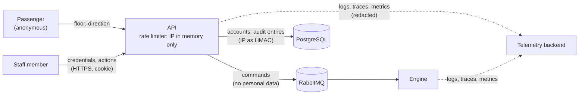

# Data protection impact report (Relatório de Impacto à Proteção de Dados Pessoais)

> [!IMPORTANT]
> System documentation draft for the data controller (controlador) and their legal counsel to
> validate. Not legal advice. Placeholders look like `{{LIKE_THIS}}`. The risk ratings are the
> engineering team's assessment and must be reviewed by the controller and the encarregado.

| | |
|---|---|
| System | ElevatorSystem: control of one elevator serving floors 1 to 10, REST API, Blazor UI, operations panel |
| Controller (controlador) | `{{CONTROLLER_LEGAL_NAME}}` |
| Encarregado | `{{DPO_NAME}}`, `{{DPO_EMAIL}}` |
| Version and date | 0.1 draft, 2026-10-19 |
| Related documents | [ROPA](ropa.md), [retention schedule](retention.md), [incident runbook](incident-response.md), [ADR-0009](../adr/0009-privacy-by-design-for-lgpd.md) |

## 1. Why this report exists

LGPD Art. 5 XVII defines the impact report (RIPD), and Art. 38 lets the ANPD require it. Art. 10
§3 allows the ANPD to request it when processing relies on legitimate interest, which is the case
for the audit trail and for part of the staff accounts (see the [ROPA](ropa.md)). The processing
is small in volume and involves no sensitive data, but it concerns employees and the security of
a safety-related system, so the report is prepared up front rather than on demand.

## 2. Description of the processing

**Nature.** The system stores staff accounts and an audit trail of staff actions in PostgreSQL.
It uses client IP addresses in memory for rate limiting and stores them in the audit trail only
as keyed hashes. Passenger requests (floor, direction, timestamps) are not personal data. Logs,
traces and metrics are designed to contain no personal data.

**Scope.** One building, so the expected number of data subjects is small: the controller's staff
and contractors with panel access, typically a few dozen people. Retention is limited to
6 months after an account is closed and 1 year for audit entries ([retention schedule](retention.md)).

**Context.** The data subjects are employees or contractors, so there is an imbalance of power
with the controller, and audit data could be misused to monitor performance. Staff reasonably
expect their privileged actions on a safety system to be recorded; they do not expect to be
tracked beyond that.

**Purposes.** Authenticate staff and limit them to their role; hold staff accountable for
privileged actions and detect misuse; protect the service from abuse. Full entries are in the [ROPA](ropa.md).

**Data flow.**

## 3. Necessity and proportionality

| Data | Why it is necessary | Less intrusive alternative considered |
|---|---|---|
| Passenger identity | **Not collected.** Calling an elevator needs only a floor and a direction. | Badges or accounts for analytics were rejected in ADR-0009: they would add personal and possibly location data with no operational need. |
| Staff name and e-mail | Identify the account holder to administrators and allow account recovery. | A shared operator login was rejected: it would make the audit trail meaningless. |
| Role | Enforce least privilege. | None; authorization requires it. |
| Password hash, TOTP secret, recovery codes | Authenticate staff securely; two-factor authentication is mandatory for administrators. | Delegating to an external identity provider remains possible later; it would move the data rather than remove it. |
| Staff ID in audit entries | Accountability for actions on a safety system. | Anonymous audit entries would not serve the purpose. |
| IP address in audit entries | Correlate actions from the same source when investigating misuse. | Raw IPs were rejected in ADR-0009; a keyed HMAC with a rotating key allows correlation within a key period without keeping the address. |
| IP address for rate limiting | Partition rate limits per client. | Kept in memory only and never stored. |

LGPD Art. 6 principles:

| Principle | How the design meets it |
|---|---|
| Purpose (finalidade) and adequacy (adequação) | Each item has a single documented purpose in the [ROPA](ropa.md). Audit data is not used for performance evaluation (see risk R3). |
| Necessity (necessidade) | Passengers are anonymous; staff data is limited to the fields listed above. Any new personal field requires a ROPA and RIPD update in the same pull request. |
| Free access (livre acesso) and data quality (qualidade dos dados) | Self-service export; staff can ask an administrator to correct their name or e-mail. |
| Transparency (transparência) | [Privacy notice](privacy-notice.md) in the UI, in en-US and pt-BR. |
| Security (segurança) and prevention (prevenção) | See section 5. |
| Non-discrimination (não discriminação) | No profiling and no automated decisions with legal or similar effects. Account lockout is a temporary security measure and can be reviewed by an administrator. |
| Accountability (responsabilização e prestação de contas) | This pack, the hash-chained audit trail, retention job run records and automated privacy tests (ADR-0010). |

## 4. Risks to data subjects

Scales: **likelihood** Low (unlikely in the system's lifetime), Medium (plausible), High (expected
without controls). **Impact** Low (inconvenience), Medium (significant but recoverable harm),
High (serious or lasting harm). The inherent level is assessed before the measures in section 5.

| ID | Risk | Harm to the data subject | Likelihood | Impact | Inherent level |
|---|---|---|---|---|---|
| R1 | Staff account takeover (phishing, password reuse, brute force) | Actions on the elevator attributed to the victim; disciplinary or legal consequences | Medium | High | High |
| R2 | Breach of the identity store (password hashes, TOTP secrets, recovery codes) | Offline password cracking and reuse on other services; two-factor bypass. This is authentication data, one of the criteria for relevant risk in Resolution CD/ANPD nº 15/2024 | Low | High | Medium |
| R3 | Audit trail used beyond its purpose, for example to monitor working hours or performance | Covert employee monitoring; loss of trust; discrimination | Medium | Medium | Medium |
| R4 | Audit entries tampered with or lost | Actions wrongly attributed to, or hidden from, a staff member | Low | High | Medium |
| R5 | Personal data leaks into logs, traces, metrics or error responses | Exposure to a wider audience, longer retention than declared, possible transfer abroad through the telemetry backend | Medium | Medium | Medium |
| R6 | Passengers singled out from request patterns (floor and time) | Inference of a person's movements | Low | Low | Low |
| R7 | Data kept beyond its retention period because the retention job fails silently | Over-retention; larger impact of any later breach | Medium | Low | Medium |
| R8 | Export or deletion acts on the wrong person (broken access control) | Disclosure of another staff member's data, or loss of their account | Low | Medium | Medium |
| R9 | The deletion right is used to erase accountability: a staff member performs a harmful action, then has their audit entries anonymised | Other staff wrongly suspected; the controller cannot investigate | Low | High | Medium |
| R10 | Data transferred abroad without an Art. 33 mechanism because of a hosting, e-mail or telemetry choice | Loss of LGPD-equivalent protection | Medium | Medium | Medium |
| R11 | A compromised dependency or build pipeline exfiltrates data | Any of the harms above, at scale | Low | High | Medium |

## 5. Mitigations

Status for every measure: planned, in the delivery phase shown. Phase 0 (foundation) is complete.

| Risk | Measures | Decision | Phase |
|---|---|---|---|
| R1 | Mandatory TOTP for administrators; lockout after 5 failed attempts; password policy; `HttpOnly`, `Secure`, `SameSite=Strict` cookies with a 20-minute sliding expiry; antiforgery tokens; deny-by-default authorization with an authorization-matrix test for every endpoint; every privileged action audited | [ADR-0006](../adr/0006-blazor-webassembly-ui-hosted-by-the-api.md), [ADR-0010](../adr/0010-testing-strategy.md) | 4 |
| R2 | ASP.NET Core Identity password hashing; TOTP secret encrypted with Data Protection; Data Protection key ring protected at rest by the deployment environment; TLS; encryption at rest by the hosting environment; least-privilege database credentials; incident runbook treats this as relevant risk by default | [ADR-0009](../adr/0009-privacy-by-design-for-lgpd.md), [ADR-0011](../adr/0011-orchestration-and-delivery.md) | 3, 4 |
| R3 | Purpose limitation stated in the ROPA and the privacy notice; audit viewer restricted to the `Auditor` role and administrators; no reports or exports of audit data by person and time beyond what an investigation needs; the controller adopts an internal policy forbidding performance monitoring through the audit trail | [ADR-0009](../adr/0009-privacy-by-design-for-lgpd.md) | 4, 5 (policy: controller) |
| R4 | Append-only, hash-chained audit entries with a verification endpoint; tombstones instead of deletion so the chain stays verifiable, using salted personal digests, with checkpoints when the oldest entries are purged; audit writer consumes events from its own queue | [ADR-0009](../adr/0009-privacy-by-design-for-lgpd.md), [ADR-0014](../adr/0014-audit-tombstones-and-chain-checkpoints.md), [ADR-0003](../adr/0003-rabbitmq-as-message-broker.md) | 4 |
| R5 | `Microsoft.Extensions.Compliance` classification and automatic redaction; `LoggerMessage` methods only; no request bodies, headers, cookies or IPs in logs; ProblemDetails without internals; a log-capture test fails on any known personal value; 30-day telemetry retention | [ADR-0009](../adr/0009-privacy-by-design-for-lgpd.md), [ADR-0010](../adr/0010-testing-strategy.md) | 2, 5 |
| R6 | No identifier attached to requests; requests never joined to other data; individual requests aggregated after 90 days; passenger screen shows only live state | [ADR-0009](../adr/0009-privacy-by-design-for-lgpd.md) | 1, 3, 5 |
| R7 | Retention job records every run (start, end, counts, outcome) in the audit trail; a health check and an alert fire when the last successful run is older than expected; integration test proves expired data is anonymised or purged ([retention schedule](retention.md#3-the-retention-job)) | [ADR-0009](../adr/0009-privacy-by-design-for-lgpd.md), [ADR-0010](../adr/0010-testing-strategy.md) | 5 |
| R8 | Export and deletion act only on the authenticated caller's own data (no user ID in the request); tests prove export returns all of the caller's data and nobody else's; deletion requires re-authentication and confirmation | [ADR-0010](../adr/0010-testing-strategy.md) | 5 |
| R9 | Hash chain and tombstones show that an anonymisation happened and when. **Open item O1:** the controller should decide whether anonymisation of audit entries still inside their retention period is deferred until the period ends, or requires a second administrator's approval, when the entries may be needed for an investigation (Art. 16 and Art. 18 §2 allow retention and opposition to be weighed) | [ADR-0009](../adr/0009-privacy-by-design-for-lgpd.md) | 5 (decision: controller) |
| R10 | No transfer by design; hosting region, e-mail provider and telemetry backend must be recorded in the ROPA before production; any transfer uses an Art. 33 mechanism such as the standard contractual clauses of Resolution CD/ANPD nº 19/2024 | [ADR-0011](../adr/0011-orchestration-and-delivery.md) | Before production (controller) |
| R11 | Central package management, lock files, NuGet audit failing the build, package source mapping, denied packages, SHA-pinned Actions, CodeQL, Dependabot, dependency review, signed build provenance, non-root chiseled images | [ADR-0008](../adr/0008-dependency-and-supply-chain-policy.md), [ADR-0011](../adr/0011-orchestration-and-delivery.md) | 0 (in place) |

## 6. Residual risk

Assessed assuming every measure in section 5 is implemented and its tests pass.

| ID | Residual likelihood | Residual impact | Residual level | Comment |
|---|---|---|---|---|
| R1 | Low | High | Medium | Operators without mandatory 2FA remain the weakest point; the controller may extend mandatory TOTP to all roles. |
| R2 | Low | Medium | Low | Hashing and encryption limit the value of a stolen database; notification is still likely to be required. |
| R3 | Low | Medium | Low | Depends on the controller's internal policy, which software cannot enforce. |
| R4 | Low | Medium | Low | Tampering is detected, not prevented; detection depends on running the verification regularly. |
| R5 | Low | Medium | Low | Tests cover known values; novel fields rely on classification at review time. |
| R6 | Low | Low | Low | |
| R7 | Low | Low | Low | |
| R8 | Low | Medium | Low | |
| R9 | Low | High | Medium | Until open item O1 is decided. |
| R10 | Low | Medium | Low | Once the processors are recorded. |
| R11 | Low | High | Medium | Supply-chain risk can be reduced, not eliminated. |

**Conclusion.** No high residual risk remains. The processing is necessary and proportionate for
its purposes, provided the open items below are closed before the system goes into production.

## 7. Open items for the controller

| ID | Item |
|---|---|
| O1 | Decide how deletion requests interact with audit entries still inside their retention period (risk R9). |
| O2 | Confirm every default retention period in the [retention schedule](retention.md). |
| O3 | Record the legitimate interest assessments (Art. 10) for operations 1 (contractors), 2 and 5 of the [ROPA](ropa.md). |
| O4 | Name the hosting, e-mail and telemetry processors and their regions, and sign data processing agreements with them. |
| O5 | Adopt an internal policy limiting use of the audit trail to security and accountability (risk R3). |
| O6 | Decide the rotation period of the HMAC key used to pseudonymise IP addresses, which bounds how long pseudonyms stay linkable. It appears as `{{HMAC_KEY_ROTATION_PERIOD}}` in the classification table and the [retention schedule](retention.md#1-schedule). |
| O7 | Appoint the encarregado and publish their contact (Art. 41 §1). |

## 8. Approval

| Role | Name | Date | Decision |
|---|---|---|---|
| Controller | `{{CONTROLLER_REPRESENTATIVE}}` | | |
| Encarregado | `{{DPO_NAME}}` | | |
| Engineering | | 2026-10-19 | Draft prepared |

## Revision history

| Date | Change | Reviewed by |
|---|---|---|
| 2026-10-19 | First draft, written ahead of phases 4 and 5 | Engineering; pending controller and counsel review |
| 2026-10-19 | R4 mitigation and item O6 linked to ADR-0014 and the classification table | Engineering; pending controller and counsel review |
