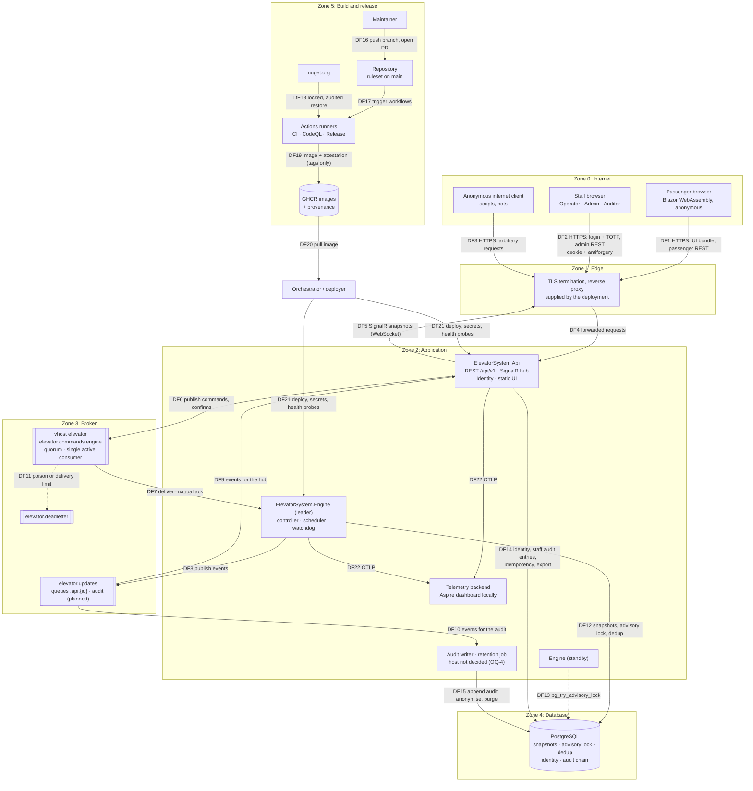

# ElevatorSystem threat model (STRIDE)

- **Version:** 1.11
- **Date:** 2026-10-19
- **Covers:** the planned architecture of ADR-0002 to ADR-0011 at the end of delivery phase 0
- **Method:** STRIDE per element and per data flow, plus elevator-specific abuse cases
- **Review rules:** see [README.md](README.md)

## Contents

1. [Scope](#1-scope)
2. [Assets](#2-assets)
3. [Actors](#3-actors)
4. [Data-flow diagram and trust boundaries](#4-data-flow-diagram-and-trust-boundaries)
5. [STRIDE per element](#5-stride-per-element)
6. [STRIDE per data flow](#6-stride-per-data-flow)
7. [Abuse cases](#7-abuse-cases)
8. [Residual risks and assumptions](#8-residual-risks-and-assumptions)
9. [Open questions](#9-open-questions)
10. [Change log](#10-change-log)

### How to read the tables

- **Phase** refers to the delivery phases in `CLAUDE.md`:
  - P0 foundation (done)
  - P1 domain and `ElevatorController`
  - P2 REST API, SignalR and the passenger view (in-memory bus)
  - P3 RabbitMQ, PostgreSQL, recovery, watchdog and failover
  - P4 authentication, roles, admin panel and the audit log
  - P5 passenger journeys, demo scenarios, observability, load, end-to-end and mutation testing
- **Status:**
  - `Implemented`: the mechanism is on `main` today, with a test or committed configuration that shows it
  - `Planned`: decided in an ADR or a project skill, not built yet
  - `Open`: no mitigation decided yet; the row links an [open question](#9-open-questions)

  A row with two statuses (for example `Implemented / Planned`) has one part in place and the
  rest pending; the mitigation text says which part is which.
- **Impact** is rated High, Medium or Low, followed by the consequence if the threat succeeds
  with no mitigation in place.
- Threat IDs (`T-API-03`) are stable. Issues and pull requests cite them.

## 1. Scope

**In scope**

- The production architecture defined by the ADRs and the `api-backend`, `messaging` and
  `security` skills:
  - the Blazor WebAssembly UI served by `ElevatorSystem.Api` from the same origin
  - the REST API under `/api/v1` and the SignalR hub `/hubs/elevator`
  - ASP.NET Core Identity with cookie authentication, antiforgery and TOTP
  - RabbitMQ (virtual host `elevator`, quorum queues, single active consumer, dead-lettering)
  - `ElevatorSystem.Engine` with the controller, the FIFO scheduler, the watchdog and leader election
  - PostgreSQL for state snapshots, the advisory lock, message deduplication, identity and the
    hash-chained audit log
  - the audit writer and the retention job (Infrastructure)
  - OpenTelemetry export
- The software supply chain: the GitHub repository and its `main` ruleset, the CI, CodeQL and
  Release workflows, Dependabot, nuget.org, and GitHub Container Registry (GHCR) with build
  provenance attestations.

**Out of scope, with the reason**

- **Elevator hardware.** The car is simulated. The model assumes the software is never the only
  safety layer of a physical installation (see [R-01](#8-residual-risks-and-assumptions) and
  [OQ-19](#9-open-questions)).
- **The production hosting environment.** ADR-0011 leaves it undefined on purpose: TLS
  termination, network segmentation, secret storage, backups and runtime hardening are supplied by
  the deployment. They are listed as assumptions, not mitigations.
- **The local Aspire setup and the console demo.** They run on a developer machine with
  development credentials and no real data.
- **Physical and social-engineering attacks on staff**, apart from phishing of credentials, which
  is analysed.

## 2. Assets

| ID | Asset | Why it matters | Security property |
|---|---|---|---|
| A1 | **Elevator safety**: the car never moves with the door open or while out of service, never leaves floors 1–10, is driven by exactly one controller, and a stuck car is detected | A violation is the worst outcome this system can have, even in simulation, because it is what the software would control in a real building | Integrity |
| A2 | **Availability of the elevator service**: passengers are served with bounded waiting time; `202 Accepted` means the request is persisted | Passengers depend on it; an emergency stop must take effect at once | Availability |
| A3 | **Staff credentials**: passwords (hashed), TOTP secrets, session cookies | They grant operator powers (emergency stop, maintenance, return to service) and administrator powers (users, roles, scheduling strategy) | Confidentiality, integrity |
| A4 | **Audit integrity**: the hash-chained log of every privileged action | It is the evidence for incidents and for accountability | Integrity, non-repudiation |
| A5 | **Personal data**: staff name, e-mail, role, audit entries with staff ID and HMAC of the IP, data exports | Staff privacy and trust; a leak exposes accounts and habits | Confidentiality, integrity |
| A6 | **Service secrets and keys**: broker and database credentials, the Data Protection key ring, the HMAC key for IP pseudonymisation | Whoever holds them can impersonate a service, forge cookies or reverse the IP pseudonyms | Confidentiality |
| A7 | **Build and release integrity**: source on `main`, workflows, lock files, container images and their provenance | A compromised build ships attacker code with valid provenance | Integrity |

## 3. Actors

| Actor | Trust | Legitimate capability | What a malicious or compromised one can try |
|---|---|---|---|
| **Passenger** | Untrusted, anonymous | Hall calls and car calls through `/api/v1/hall-calls` and `/api/v1/car-calls`, read state through `/api/v1/elevator` and the hub | Press every button repeatedly; send invalid floors |
| **Anonymous internet client** | Untrusted | The same anonymous surface as a passenger, plus the login page and static assets | Floods, scanning, credential stuffing, exploiting parser or framework bugs, opening many hub connections |
| **Operator** | Authenticated, `CanOperate` | Emergency stop, maintenance mode, return to service, live operations view | Abuse safety commands; return a faulted car to service; escalate to administrator |
| **Admin** | Authenticated with TOTP, `CanAdminister` | User and role management, scheduling strategy, everything an operator can do | Create accounts, erase traces, disable controls (insider case) |
| **Auditor** | Authenticated, `CanAudit` | Read the audit trail and run its verification | Take personal data out of the audit trail; act beyond read access |
| **Compromised dependency** | Runs with the privileges of the process that loads it | NuGet package, GitHub Action, base image or the broker and database servers themselves | Exfiltrate secrets, publish forged commands, tamper with the build |
| **Malicious insider** | Has legitimate access to something | A staff member, a database or broker administrator, a person with deployment access, or a repository maintainer | Tamper with the audit trail, start a second engine, change watchdog configuration, push a release |

The **maintainer** (who merges to `main` and pushes release tags) and the **deployer** (who runs
the containers and supplies secrets) are trusted roles. Their compromise is covered under
"malicious insider" and in the residual risks.

## 4. Data-flow diagram and trust boundaries

Each subgraph is a trust zone. A flow that leaves a zone crosses a trust boundary. Flow
IDs (`DF6`) are used in the STRIDE tables.

### Trust boundaries

| ID | Boundary | Crossed by | What changes when crossing it |
|---|---|---|---|
| TB1 | **Browser to API** (Zone 0 to Zones 1 and 2) | DF1–DF5 | Every byte is untrusted. The WebAssembly bundle is public code, so nothing in the browser is a control. All validation, authorization and rate limiting happen in the API (ADR-0006). |
| TB2 | **Operators: the staff privilege boundary inside the API** | DF2, DF14 | Anonymous to authenticated, then `CanOperate`, `CanAdminister` and `CanAudit`. A logical boundary enforced by Identity and authorization policies, with the root group denying by default. |
| TB3 | **API to RabbitMQ** (Zone 2 to Zone 3) | DF6, DF9 | The API is the only producer of commands. Broker identity is the per-service RabbitMQ user (messaging skill). |
| TB4 | **Engine to RabbitMQ and PostgreSQL** (Zone 2 to Zones 3 and 4) | DF7, DF8, DF12, DF13 | The engine accepts commands from the broker and treats each one as untrusted input. Leadership comes from the database. |
| TB5 | **Services to PostgreSQL** (Zone 2 to Zone 4) | DF12–DF15 | Data at rest: identity, the audit chain, snapshots. Database roles per service are not defined yet ([OQ-7](#9-open-questions)). |
| TB6 | **CI/CD pipeline** (Zone 5) | DF16–DF19 | Untrusted pull-request code runs on GitHub-hosted runners with a read-only token. Only tag pushes get `packages: write`, `id-token: write` and `attestations: write`. |
| TB7 | **Container registry to deployment** (Zone 5 to the orchestrator) | DF20, DF21 | Images leave GitHub's control. Their integrity is provable only through the provenance attestation. Secrets enter only here, from the deployment environment (ADR-0011). |

## 5. STRIDE per element

STRIDE categories with no row for an element were considered and do not apply. The reason is
given under the element's heading.

### 5.1 Browser client (Blazor WebAssembly)

Repudiation does not apply: the browser holds no record of anything. Denial of service against
one user's own browser is out of scope.

| ID | STRIDE | Threat | Impact | Mitigation | Status |
|---|---|---|---|---|---|
| T-WEB-01 | S | A phishing site imitating the admin panel relays a staff password and the TOTP code in real time | High: admin account takeover (A3) | TOTP for admins, lockout after 5 failures, HSTS. Relayed TOTP codes are still phishable ([R-05](#8-residual-risks-and-assumptions)). | Implemented (HSTS, `UseHsts` outside Development) / Planned (Identity, TOTP, lockout: ADR-0006, P4) |
| T-WEB-02 | T | The user edits the public WebAssembly client to skip validation or to show hidden admin buttons | Low: only if the server trusted the client | The UI is just another API client. Every rule is enforced again in the API, and hiding UI is convenience only (ADR-0006). `Web` references only `Contracts`, enforced by the architecture tests (ADR-0002). | Implemented (architecture tests) / Planned (server enforcement: P2, P4) |
| T-WEB-03 | I | Cross-site scripting reads data or acts as the logged-in staff member | High: staff session misuse | Cookies are `HttpOnly`, so script can't read them. CSP `default-src 'self'; script-src 'self' 'wasm-unsafe-eval'; style-src 'self' 'unsafe-inline'; img-src 'self' data:; font-src 'self' data:; connect-src 'self'; frame-ancestors 'none'; base-uri 'self'; form-action 'self'` with no inline scripts, on every response (`SecurityHeaders`, tested by `SecurityHeadersTests`). Razor encodes output, and raw `MarkupString` from data is forbidden (ADR-0006, api-backend and blazor-ui skills). | Implemented (CSP: P2) / Planned (cookies: P4) |
| T-WEB-04 | I | Secrets or tokens are shipped in the bundle or kept in `localStorage` | High: the bundle is public | No access or refresh tokens ever reach the browser (backend-for-frontend, ADR-0006). `localStorage` holds one key, `elevator.culture` (`en-US` or `pt-BR`, any other value is ignored; ADR-0013), and `sessionStorage` one, `elevator.passenger`, the random id of this tab's anonymous passenger (ADR-0026, ADR-0035). The id names no person, grants nothing beyond moving that passenger, and is checked against the server, which forgets idle passengers. No staff session data is stored (the session is an HttpOnly cookie, ADR-0022). | Implemented (P2: `CulturePreference`; P4: sign-in; passenger journey: `PassengerJourney`) |
| T-WEB-05 | E | Cross-site request forgery: a hostile page makes an operator's browser send an emergency stop or return to service | High: unauthorised safety command (A1, A2) | `SameSite=Strict` cookies plus antiforgery validation on every state-changing request made with a cookie (ADR-0006, api-backend skill) | Planned (P4) |
| T-WEB-06 | E | Clickjacking: the admin panel is framed and a confirmation button is overlaid | Medium | `frame-ancestors 'none'` in the CSP on every response, and confirmation dialogs that name the effect for safety actions (blazor-ui skill) | Implemented (CSP: P2) / Planned (dialogs: P4) |

### 5.2 API host (`ElevatorSystem.Api`)

| ID | STRIDE | Threat | Impact | Mitigation | Status |
|---|---|---|---|---|---|
| T-API-01 | S | Credential stuffing or brute force against staff login | High: account takeover (A3) | Identity password policy (12+ characters), lockout for 15 minutes after 5 failures (wrong second-factor codes count), a per-address rate limit on sign-in, and a second factor (TOTP or a recovery code) required for every staff capability, whatever the role. Unknown e-mails and wrong passwords get the same answer and cost the same hash (ADR-0022, `StaffSignInTests`). Exception: the configured test account signs in with its public password only (ADR-0030); it is off unless `Staff:TestAccount` is set, never applies to an existing account, and must be turned off wherever the system is exposed (`TestAccountTests`). | Implemented (P4); test account accepted risk (ADR-0030) |
| T-API-02 | S | A stolen session cookie is replayed, or stays valid after an account is disabled or a role is removed | High | `__Host-` cookie: `Secure`, `HttpOnly`, `SameSite=Strict`, no persistent expiry, 20-minute sliding (ADR-0022). The security stamp is re-checked every minute, and a hub connection closes when its cookie expires. Disabling an account is still configuration only. | Implemented (P4) |
| T-API-03 | S | A client forges `X-Forwarded-For` to dodge per-IP rate limits or to poison the IP pseudonym in the audit trail | Medium: flooding (A2), wrong audit evidence (A4) | Forwarded-headers handling with known proxies is not specified ([OQ-10](#9-open-questions)) | Open (OQ-10) |
| T-API-04 | T | Malformed or hostile input: floor 0 or 11, unknown direction, overposting, oversized or deeply nested JSON | Medium | Strict JSON at the boundary: unknown enum names, missing fields, numbers sent as strings and malformed bodies are `400` problems, never `500`; bodies over 1 KB are refused (`413`, Kestrel). The domain rejects out-of-range floors and impossible directions (`Building.Validate`, P1) as `400` with a `reason`. Records bind only their own fields, so overposting has no effect. Tested by `PassengerRequestTests` (ADR-0010). | Implemented (P1, P2) |
| T-API-05 | T | A state-changing request is replayed, or a retry creates duplicate work | Low for passengers (duplicates merge, ADR-0005), Medium for admin actions | Antiforgery tokens on every staff `POST`. An `Idempotency-Key` on service actions returns the first acceptance to a retry, scoped per account and kept in memory for 10 minutes (ADR-0022, `ServiceActionTests`). Shared storage is needed if the API ever runs as several instances. | Implemented (P4) |
| T-API-06 | T | Host header injection poisons links the server builds, such as Identity password-reset or confirmation e-mails | High: reset tokens sent to an attacker's host | `AllowedHosts` set per environment and never `*` in production (api-backend skill). The base `appsettings.json` still has `"*"`, so the production override is required. | Planned (P2, P4) |
| T-API-07 | R | A staff member denies having sent an emergency stop, a return to service, a scheduling switch or a role change | High: no accountability (A4) | Every privileged action writes an audit entry with staff ID, action, timestamp and HMAC-SHA256 of the IP, in the hash chain (ADR-0024, security skill) | Planned (P4) |
| T-API-08 | I | Errors reveal stack traces, exception messages or framework versions | Medium | `AddProblemDetails()`, `UseExceptionHandler` outside Development, Kestrel server header off. Every error under `/api` (refusals, 404, 405, 415, malformed JSON, unhandled exceptions) is an RFC 9457 problem carrying only `traceId` and, for refusals, a `reason` (`ApiErrorHandling`, tested by `ApiErrorTests`). | Implemented (P0, P2) |
| T-API-09 | I | Development surfaces are reachable in production: OpenAPI, the API reference UI, detailed health output | Medium: reconnaissance, dependency status | OpenAPI and the reference UI are mapped in Development only (`ApiErrorTests` checks both answer `404` in Production). Health endpoints are mapped only in Development (`MapDefaultEndpoints`). How production probes are exposed is still to be decided ([OQ-9](#9-open-questions)). | Implemented (health, OpenAPI: P2) / Open (OQ-9) |
| T-API-10 | I | Personal data (e-mail, IP, cookie) reaches logs, traces or metrics | High: privacy breach (A5) | No request bodies, headers, cookies or IPs in logs. `Microsoft.Extensions.Compliance` classification with `AddRedaction()` and `LoggerMessage` with `[LogProperties]`. A `FakeLogger` test fails on any known personal value (ADR-0024, security skill). | Planned (P4, P5) |
| T-API-11 | I | Insecure direct object reference in `/api/v1/me`: a caller exports or deletes someone else's data | High (A5) | The subject is taken only from the authenticated principal; the endpoint takes no user ID. A privacy test proves that an export returns the caller's data and nobody else's (testing skill, ADR-0024). | Planned (P5) |
| T-API-12 | D | Request flooding on the anonymous request endpoints | High (A2) | See [AC-1](#ac-1-request-flooding). Token-bucket rate limits per client address (IPv6 per /64), a global concurrency limiter on `/api`, the bounded intake channel and request merging (`RateLimiting`, tested by `RateLimitingTests`). | Implemented (P1, P2) |
| T-API-13 | D | Thousands of anonymous SignalR connections exhaust memory or sockets | High (A2) | Not specified: there is no per-IP or global connection limit for the hub ([OQ-11](#9-open-questions)) | Open (OQ-11) |
| T-API-14 | D | The broker is unreachable and requests are accepted but lost | High: a passenger is told "accepted" and never served | `202` only after a publisher confirm. Otherwise `503` with `Retry-After`, and readiness reports `Degraded` (ADR-0003, messaging skill). The adapter side is built (ADR-0018 §4–5): publishing completes only after the broker's ack and throws `MessagingUnavailableException` on a nack, a return, a timeout or a lost connection, and the `rabbitmq` health check (tag `ready`) reports `Degraded` while disconnected. The API publishes every call and maps that exception to `503` with `Retry-After: 2` and reason `Busy` (ADR-0021 §7, `BrokerOutageTests`). | Implemented |
| T-API-15 | E | A new endpoint is shipped without an authorization rule | High | The root `/api/v1` group requires authorization, and anonymous endpoints must opt out with `.AllowAnonymous()` and a rate limit. An authorization-matrix test (endpoint × anonymous, Auditor, Operator, Admin) is mandatory for every endpoint (api-backend skill, ADR-0010). Until then every P2 endpoint is explicitly `AllowAnonymous` with a rate-limit policy. | Implemented (explicit anonymous endpoints: P2) / Planned (deny-by-default group, matrix test: P4) |
| T-API-16 | E | An operator escalates to admin through user management, for example a role field in a request body | High | Policies (`CanOperate`, `CanAdminister`, `CanAudit`), never role strings, in endpoints. Explicit request contracts, so there is no binding to entity types. Matrix tests. Every role change is audited. | Planned (P4) |
| T-API-17 | E | Remote code execution in the API (framework bug or hostile package) gives the attacker the API's broker and database credentials | High: forged commands ([AC-2](#ac-2-forged-commands-on-the-broker)), data theft | Non-root chiseled image with no shell or package manager (ADR-0011). Broker user limited to writing to `elevator.commands` and reading its own `elevator.updates.api.*` queues (messaging skill). The adapter only requires a user name and password from secrets; the per-service users and the `elevator` virtual host are deployment configuration that doesn't exist yet (ADR-0018). Database least privilege is not defined ([OQ-7](#9-open-questions)). | Implemented (image) / Planned (broker user and virtual host: P3) / Open (OQ-7) |

### 5.3 Engine (`ElevatorSystem.Engine`)

Information disclosure is limited: the engine serves only health endpoints (`Program.cs`), and
those exist only in Development today. Its data holds no personal data (passengers are anonymous,
ADR-0024).

| ID | STRIDE | Threat | Impact | Mitigation | Status |
|---|---|---|---|---|---|
| T-ENG-01 | S | A second engine (a mistaken deploy, a network partition, a process paused and then resumed) believes it is the leader and drives the car | High (A1) | See [AC-3](#ac-3-two-controllers-driving-one-car). PostgreSQL advisory lock plus single active consumer (ADR-0007 §7). There is no fencing token yet ([OQ-3](#9-open-questions)). The engine drives the car and consumes commands only while it holds the lease, and stops both the moment the lease is lost (ADR-0021 §1, `ElevatorEngineTests`, `KillingTheLeader…` integration test). | Implemented / Open (OQ-3) |
| T-ENG-02 | T | A forged or malformed command reaches the engine | High (A1) | Every message is validated as untrusted input. A message that can't be deserialised or validated is rejected without requeue and goes to the dead-letter queue (messaging skill). The adapter does this for transport faults: bad JSON, an unknown type, an undefined enum value, an empty ID, a wrong content type or a body over 64 KiB (ADR-0018 §2, Messaging tests). Illegal transitions are refused by the state machine itself, whoever sends them (ADR-0007 §1). The engine consumes from the broker and validates floors and directions again; a call it refuses is reported as a `RequestRejected` activity (ADR-0021 §6). | Implemented |
| T-ENG-03 | T | A tampered or corrupt state snapshot puts the car in an impossible state on restart (floor 15, door open while moving) | High (A1) | Domain types enforce the invariants (`1 ≤ CurrentFloor ≤ 10`, no movement with the door open; elevator-domain skill), so restore has to go through them. A snapshot that `Elevator.Restore` refuses is logged (event 2007) and the engine starts from an empty state at the lowest floor, keeping the stored version (ADR-0021). Whether an operator should be alerted instead is still open ([OQ-17](#9-open-questions)). | Implemented / Open (OQ-17) |
| T-ENG-04 | R | The source of a safety command can't be traced: which staff member caused an emergency stop or a return to service | High (A4) | The API writes an audit entry naming the admin and the command ID before it publishes the command (ADR-0023); the engine logs and reports the same command ID. Staff identities never travel on the broker. | Implemented (P4) |
| T-ENG-05 | D | A slow or down broker or database stalls the control loop | High (A1, A2) | The control loop never awaits I/O. Events leave through a bounded buffer (ADR-0007 §4, `IElevatorEventSink`). For browser updates the buffer drops its oldest event when full, counts and logs it, and clients resync from the next status (ADR-0015, tested by `FanOutIsolationTests`). In the engine, updates and snapshot saves leave through background workers the loop never awaits: the update buffer drops its oldest entry when full (event 2014), and a failing save is retried while the car keeps operating (ADR-0021 §3, `ElevatorEngineFailSafeTests`). What happens to audit events when the engine's buffer is full is not specified ([OQ-5](#9-open-questions)). | Implemented / Open (OQ-5) |
| T-ENG-06 | D | A poison command crashes the loop over and over | High (A2) | A failing command is caught, logged and rejected while the loop continues (ADR-0007 §5). Delivery limit 5, then dead-letter: the adapter turns a handler exception into a nack with requeue, and the broker dead-letters the command on the sixth failure (ADR-0018 §2, Messaging tests). An unrecoverable failure stops the host (`BackgroundServiceExceptionBehavior.StopHost`) so the orchestrator restarts it. | Implemented |
| T-ENG-07 | D | An emergency stop waits in the broker queue behind passenger commands | High (A1) | In the engine, safety commands skip the intake channel and take the car lock (ADR-0004). On the broker they share the single FIFO commands queue (ADR-0003), so they wait behind everything ahead of them ([OQ-1](#9-open-questions)). | Open (OQ-1) |
| T-ENG-08 | D | The watchdog is disabled, misconfigured or never runs | High (A1) | See [AC-5](#ac-5-disabling-the-watchdog) | Planned (P3) / Open (OQ-18) |
| T-ENG-09 | E | A command that needs operator rights (return to service) is honoured without any check in the engine | High (A1) | By design the API is the single enforcement point (ADR-0006), and only the API's broker user can publish commands (messaging skill). The engine trusts that the API authorised the command ([R-02](#8-residual-risks-and-assumptions)). | Planned (P3, P4) |

### 5.4 RabbitMQ

| ID | STRIDE | Threat | Impact | Mitigation | Status |
|---|---|---|---|---|---|
| T-MQ-01 | S | A client connects as a service using the `guest` account or leaked credentials | High: forged commands or events | `guest` is never used. Each service has its own user, and credentials come from Aspire parameters or user-secrets locally and from environment secrets in deployment (messaging skill). The AppHost runs the broker with the user `elevator` and a password Aspire generates and keeps in the AppHost user secrets (ADR-0021 §9). One user serves both services locally; per-service users are deployment configuration. | Implemented (local) / Planned (per-service users: deployment) |
| T-MQ-02 | S | A process with valid broker access publishes as another service, for example forged events that look like the engine's | High: false state in the UI and false audit entries | Per-service permissions: only the engine user may write to `elevator.updates` (messaging skill). Validated `user-id` properties are not in the design ([AC-2](#ac-2-forged-commands-on-the-broker)). | Planned (P3) |
| T-MQ-03 | T | Someone with management access purges, moves or edits queued messages, or changes policies | High (A1, A2, A4) | Dedicated `elevator` virtual host (messaging skill). How the management interface is exposed and who holds administrator access is not specified ([OQ-20](#9-open-questions)). | Planned (P3) / Open (OQ-20) |
| T-MQ-04 | R | A published message can't be attributed to a connection or user | Medium | `message-id` (the command or update ID), `correlation-id` (the trace ID) and `traceparent` on every message give traceability (ADR-0018 §6, Messaging tests). They do not authenticate the publisher: that needs the per-service broker users of T-MQ-01, which don't exist yet. | Implemented (envelope headers) / Planned (broker users: P3) |
| T-MQ-05 | I | Messages are read by an unauthorised consumer | Low: commands and events hold no personal data (ADR-0024) | Read permissions per service user; TLS outside local development (messaging skill) | Planned (P3) |
| T-MQ-06 | D | The commands queue grows without limit while the engine is down, and then very old calls are replayed | Medium: broker disk alarm blocks every publisher; the car serves calls that are hours old | Rate limits at the API cap the inflow. `elevator.commands.engine` declares `x-overflow: reject-publish` (the at-least-once dead-letter strategy needs it), but it still has no `x-max-length` or message TTL, so the overflow policy never applies and old calls never expire (ADR-0018 §1, [OQ-6](#9-open-questions)). | Implemented (rate limits: P2) / Open (OQ-6) |
| T-MQ-07 | E | A service user with `configure` permission deletes or redeclares queues, for example to remove `x-single-active-consumer` | High (A1) | Topology is declared idempotently at startup by Infrastructure (messaging skill), so service users need `configure` rights. That conflicts with least privilege ([OQ-8](#9-open-questions)). | Open (OQ-8) |

### 5.5 PostgreSQL

| ID | STRIDE | Threat | Impact | Mitigation | Status |
|---|---|---|---|---|---|
| T-DB-01 | S | All services share one powerful database role, so a compromise of any of them is a compromise of all of them | High (A4, A5) | Not specified: per-service roles and grants are defined for the broker but not for the database ([OQ-7](#9-open-questions)) | Open (OQ-7) |
| T-DB-02 | T | SQL injection | High | EF Core only, parameterised, with no SQL built from strings (security checklist). CodeQL with `security-extended` queries runs on every pull request and is a required check. | Implemented (CodeQL) / Planned (EF Core: P3) |
| T-DB-03 | T | Audit entries are edited, deleted, reordered or truncated | High (A4) | See [AC-4](#ac-4-tampering-with-the-audit-trail). The verification endpoint finds the first edited, removed or moved entry (ADR-0023, `AuditTrailEndpointTests`); truncating the tail is found only against a head hash noted elsewhere. | Implemented (P4) / Open (OQ-14, anchoring) |
| T-DB-04 | R | Changes made directly in the database are not attributable | Medium | The hash chain detects changes to audit rows. No database-level audit (for example `pgaudit`) is planned; it depends on the deployment. | Open (OQ-7) |
| T-DB-05 | I | Identity data leaks: password hashes, TOTP secrets, e-mails | High (A3, A5) | Identity password hashing (PBKDF2). The authenticator key and recovery codes are encrypted with Data Protection before they are stored (`ProtectedStaffUserStore`, ADR-0022). The key ring is in the staff database; it is not yet encrypted at rest with a key from outside the database ([OQ-13](#9-open-questions)). | Implemented (P4) / Open (OQ-13, key ring encryption) |
| T-DB-06 | D | A database outage stops the car | High (A2) | ADR-0007 §4 says the car keeps operating, but losing the database connection also loses the advisory lock, and the messaging skill says the loop then stops accepting work ([OQ-2](#9-open-questions)) | Open (OQ-2) |
| T-DB-07 | D | Any process with database access takes the advisory lock and holds it, so the real engine can never lead | High (A2) | Advisory locks are not permission-checked beyond being able to connect to the database. Mitigated only by restricting who can connect ([OQ-7](#9-open-questions)). | Open (OQ-7) |

### 5.6 Audit writer and retention job

| ID | STRIDE | Threat | Impact | Mitigation | Status |
|---|---|---|---|---|---|
| T-AUD-01 | T | Two writers (the API for staff actions, the audit consumer for engine events) append at the same time and fork the hash chain | High: the chain fails verification and real tampering can't be told apart (A4) | The API is the only writer (ADR-0023). Appends are serialised in the process, and the sequence is the primary key, so another instance gets a conflict and retries after the new head instead of forking (`AuditTrailTests`, `StaffDatabaseTests`). | Implemented (P4) |
| T-AUD-02 | T | Anonymisation for a deletion request rewrites hashed fields and breaks verification | High (A4) | The chain covers a salted per-entry digest of the personal fields (ADR-0014, accepted). Anonymisation erases the fields and the salt and keeps the digest, so the chain still verifies (`AuditTrailTests`, `AuditTrailEndpointTests`). Checkpoints for purging arrive with the retention job; anchoring stays open ([OQ-14](#9-open-questions)). | Implemented (P4) / Planned (checkpoints: P5) / Open (OQ-14, anchoring) |
| T-AUD-03 | R | The retention job, misconfigured, purges evidence early, or it fails silently | Medium (A4, A5) | Retention periods are configuration defaults set by the operator, and the job records each run (security skill, ADR-0024) | Planned (P5) |
| T-AUD-04 | I | An auditor's export of the audit trail spreads staff IDs and IP pseudonyms | Medium (A5) | Read access only through `CanAudit`. The IP is stored only as HMAC-SHA256 with a rotating key (ADR-0024). | Planned (P4) |
| T-AUD-05 | D | Audit events are lost when the engine's event buffer or the audit queue overflows | High: incomplete evidence (A4) | A quorum queue on `elevator.updates` for the audit consumer (messaging skill: "later: audit"). It isn't declared yet, and it can't be one of ADR-0018's subscriber queues, which are exclusive, capped at 1,000 messages and drop the oldest. The overflow policy of the engine's bounded buffer is not specified ([OQ-5](#9-open-questions)). | Planned (P3) / Open (OQ-5) |
| T-AUD-06 | E | The retention job's database role can update and delete audit rows, so whoever holds it can rewrite history | High (A4) | Not specified ([OQ-7](#9-open-questions)) | Open (OQ-7) |

### 5.7 CI/CD pipeline (GitHub repository and Actions)

Denial of service (GitHub or nuget.org being unavailable) delays work but doesn't harm the
assets, so it is accepted.

| ID | STRIDE | Threat | Impact | Mitigation | Status |
|---|---|---|---|---|---|
| T-CI-01 | S | Someone pushes directly to `main` or rewrites its history | High (A7) | Repository ruleset "Protect main": pull request required, no bypass actors, deletion and non-fast-forward blocked, linear history, required checks (`Build and test`, `Analyze (csharp)`, `Analyze (actions)`, `Dependency review`) with strict up-to-date policy, and a CodeQL gate on high-severity alerts. Required approvals are 0 because there is a single maintainer ([R-07](#8-residual-risks-and-assumptions)). | Implemented (P0) |
| T-CI-02 | T | A hostile package arrives through typosquatting, dependency confusion or a compromised maintainer | High (A7) | `NuGet.config` clears sources and maps every package to nuget.org. Lock files with content hashes, restored with `--locked-mode` in CI. Central versions with transitive pinning. NuGet audit at `low` for all packages fails the build. Denied packages enforced by `PackagePolicyTests`. Dependency review fails pull requests that add a vulnerable package (ADR-0008). | Implemented (P0) |
| T-CI-03 | T | A third-party GitHub Action is compromised, or a tag is moved to malicious code | High (A7) | Every action pinned to a full commit SHA, updated through grouped Dependabot pull requests; CodeQL analyses the workflows (ADR-0008) | Implemented (P0) |
| T-CI-04 | T | Script injection in a workflow through attacker-controlled context, such as a pull-request title | High (A7) | Workflows pass context through `env:` variables, not inline `${{ }}` in `run:`. Pull requests use `pull_request`, not `pull_request_target`. CodeQL `actions` analysis is a required check. | Implemented (P0) |
| T-CI-05 | I | A workflow leaks the token or secrets | High (A6, A7) | `permissions: contents: read` by default, elevated per job. `persist-credentials: false` on every checkout. Pull-request jobs reference no secrets, and pull requests from forks receive none. Only the release job can write packages. | Implemented (P0) |
| T-CI-06 | R | A commit's author can't be proven | Low | Pull-request history and the ruleset show who merged. Signed commits are not required ([R-07](#8-residual-risks-and-assumptions)). | Implemented (P0, partial) |
| T-CI-07 | E | The release workflow is started from an unreviewed commit by pushing a `v*.*.*` tag | High (A7): an image with valid provenance built from unreviewed code | The release re-runs the restore, build and tests. No ruleset protects tags or checks that the tagged commit is on `main` ([OQ-16](#9-open-questions)). | Implemented (re-verify) / Open (OQ-16) |

### 5.8 Container registry and deployment

Repudiation does not apply here: provenance attestations record which workflow run and commit
produced each image.

| ID | STRIDE | Threat | Impact | Mitigation | Status |
|---|---|---|---|---|---|
| T-REG-01 | S | A look-alike image is deployed instead of the real one | High (A1, A7) | Signed build provenance attestations, verifiable with `gh attestation verify` (ADR-0011). Deployers are not yet required to verify them ([OQ-16](#9-open-questions)). | Implemented (attestation) / Open (OQ-16) |
| T-REG-02 | T | The mutable `latest` tag is repointed, or a deployment follows it | Medium | Version tags plus `latest` are pushed (release workflow). Deploying by digest is not required ([OQ-16](#9-open-questions)). | Open (OQ-16) |
| T-REG-03 | I | Secrets are baked into an image or into `appsettings*.json` | High (A6) | Production configuration comes from the deployment environment, never from images (ADR-0011). No secrets in code or `appsettings*.json` (security checklist). | Planned (P3, P4) |
| T-REG-04 | D | The registry is unavailable during a rollout | Low | Accepted. Running containers keep working. | Accepted |
| T-REG-05 | E | A compromised process escapes or escalates inside its container | High | Non-root user and chiseled `noble-chiseled-extra` base with no shell or package manager (`ContainerFamily` in the API and engine project files, ADR-0011). Runtime hardening (read-only root file system, dropped capabilities, seccomp) is the deployment's job ([R-08](#8-residual-risks-and-assumptions)). | Implemented (image) |

## 6. STRIDE per data flow

Threats to the endpoints of a flow are in section 5. This section covers the flows themselves:
spoofing of the peer, tampering and disclosure in transit, and interruption.

| ID | Flow | STRIDE | Threat | Impact | Mitigation | Status |
|---|---|---|---|---|---|---|
| T-DF-01 | DF1–DF4 browser → edge → API | T, I | Interception or modification on the network | High: session theft (A3) | HTTPS everywhere with HSTS (365 days, include subdomains). `UseHttpsRedirection`. TLS termination at the edge belongs to the deployment (ADR-0011). | Implemented (HSTS, redirect) / Planned (edge: deployment) |
| T-DF-02 | DF4 edge → API | S | The API trusts proxy headers from any source, so a client chooses its own IP or scheme | Medium | Forwarded headers accepted only from known proxies ([OQ-10](#9-open-questions)) | Open (OQ-10) |
| T-DF-03 | DF4 API on its public endpoint | D | Slow-request (Slowloris) or oversized-body attacks | Medium (A2) | Kestrel's default request-body size and header-timeout limits, plus the rate limiters (api-backend skill). An edge proxy with its own limits is assumed ([R-04](#8-residual-risks-and-assumptions)). | Planned (P2) |
| T-DF-04 | DF5 hub → browser | S, E | Cross-site WebSocket hijacking: a hostile page opens the hub with the staff member's cookie and joins admin groups | High | `SameSite=Strict` cookies are not sent on cross-site requests. Admin hub groups require `CanOperate`. The hub accepts no commands (api-backend skill). | Planned (P2, P4) |
| T-DF-05 | DF5 hub → browser | I | Anonymous clients receive more than the elevator state, such as staff names in admin notifications | Medium (A5) | Anonymous clients only receive `ElevatorSnapshot` data (floors, states). Admin-only events go to authorised groups. | Planned (P2, P4) |
| T-DF-06 | DF6 API → broker | T, I | Commands are changed or read in transit | High (A1) | TLS outside local development, per-service credentials (messaging skill) | Planned (P3) |
| T-DF-07 | DF6 API → broker | D | The confirm times out and the API accepts the request without durability | High (A2) | Publisher confirms; `202` only after a confirm, otherwise `503` with `Retry-After` (ADR-0003). The adapter waits for the confirm and throws `MessagingUnavailableException` after `PublishTimeout` (5 s by default) or on a nack, a return or a lost connection (ADR-0018 §5). The API maps it to `503` with `Retry-After` (ADR-0021 §7). | Implemented |
| T-DF-08 | DF6 API → broker | T | A retry after a lost confirm publishes the same command twice under a new `message-id` | Low: identical calls merge (ADR-0005) | Merging in the scheduler absorbs duplicates. Deduplication on `message-id` covers redeliveries only. | Planned (P1, P3) |
| T-DF-09 | DF7 broker → engine | T | A redelivery after a crash applies a command twice | Medium (A1) for non-idempotent admin commands | Manual ack after the handler completes, so a command whose consumer dies is redelivered (ADR-0018 §2, tested by "consumer killed before ack"). The engine marks each `CommandId` in `IProcessedCommandStore` (7 days, ADR-0019) before applying it and drops any copy (ADR-0021 §6, `DuplicatedCommand_IsAppliedOnce`). Residual: a crash between the mark and the next snapshot save loses that one call; if the store is unreachable the command is applied anyway and a copy merges into the pending call. | Implemented |
| T-DF-10 | DF7 broker → engine | D | The engine's intake channel is full when a command arrives from the broker, but the API has already answered `202` | High: an accepted request is dropped | The `RequestElevator` "busy" result (ADR-0004) is meant for a synchronous caller. For broker deliveries the engine acknowledges the command and publishes a `RequestRejected` activity with reason `Busy`, so the passenger sees the refusal on the hub and can press again (ADR-0021 §6). Safety commands still queue behind calls on the broker ([OQ-1](#9-open-questions)). | Implemented / Open (OQ-1) |
| T-DF-11 | DF8, DF9 engine → broker → API | T | Forged events make the UI show a false state, for example "doors closed" | Medium | Only the engine user may write to `elevator.updates`. The API consumes only its own `elevator.updates.api.{id}` queues, which are exclusive to the connection that declared them (ADR-0018 §3, messaging skill). The per-service broker users that enforce the write rule don't exist yet. | Implemented (exclusive subscriber queues) / Planned (broker users: P3) |
| T-DF-12 | DF10 broker → audit writer | R | Audit events are lost or duplicated | High (A4) | Quorum queue, manual ack, deduplication on `message-id` (messaging skill) | Planned (P3) / Open (OQ-5) |
| T-DF-13 | DF11 → dead-letter queue | D | Dead-lettered commands go unnoticed, so passengers are silently not served | Medium (A2) | Any message in `elevator.deadletter` raises an alert, and a dead-lettered-messages metric is exported (messaging skill). The adapter already routes poison commands, commands past the delivery limit and updates a subscriber couldn't handle to the quorum queue `elevator.deadletter` and logs each one at error level (ADR-0018 §2–3), but neither the metric nor the alert exists yet. | Implemented (dead-letter routing, error logs) / Planned (metric and alert: P3) |
| T-DF-14 | DF12–DF15 services → PostgreSQL | T, I | Interception of snapshots, identity data or audit data | High (A3, A5) | TLS on database connections ("TLS everywhere", security skill). Credentials from environment secrets (ADR-0011). | Planned (P3) |
| T-DF-15 | DF12, DF13 advisory lock connection | S, D | The leader's lock connection drops silently, a standby takes the lock, and the old leader has not noticed yet | High (A1) | See [AC-3](#ac-3-two-controllers-driving-one-car) and [OQ-3](#9-open-questions) | Open (OQ-3) |
| T-DF-16 | DF16, DF17 maintainer → GitHub → runners | T | Pull-request code changes workflows to get secrets | High (A7) | `pull_request` events give fork code a read-only token and no secrets. Workflow changes go through the same ruleset and the CodeQL `actions` check. | Implemented (P0) |
| T-DF-17 | DF18 nuget.org → runner | T | A package is swapped in transit or on the feed | High (A7) | HTTPS to nuget.org. Lock-file content hashes are verified on locked restore. Package source mapping. | Implemented (P0) |
| T-DF-18 | DF19 runner → GHCR | T, S | An image is pushed by something other than the release workflow, or changed after the push | High (A7) | Only the tag-triggered release job has `packages: write`. The provenance attestation (OIDC-signed by GitHub) binds the image digest to the workflow run and commit. | Implemented (P0) |
| T-DF-19 | DF20 GHCR → orchestrator | T | The orchestrator pulls a different image than the one attested | High (A1, A7) | Pull by digest and verify the attestation before admission ([OQ-16](#9-open-questions)) | Open (OQ-16) |
| T-DF-20 | DF21 orchestrator → services | I | Secrets leak through environment dumps, logs or crash reports | High (A6) | Secrets come from environment secrets, never from images or `appsettings` (ADR-0011). No secrets in logs (security checklist). The secret store itself is the deployment's job ([R-08](#8-residual-risks-and-assumptions)). | Planned (P3, P4) |
| T-DF-21 | DF21 health probes | I, D | Probes expose dependency details, or are missing so a hung host is never restarted | Medium (A2) | Health endpoints are Development-only today. The production design (internal port plus host filtering) is still to be decided ([OQ-9](#9-open-questions)). | Implemented (Development only) / Open (OQ-9) |
| T-DF-22 | DF22 services → telemetry | I | Personal data in traces or logs reaches a telemetry backend with different access and retention | High (A5) | Redaction at the source with the `FakeLogger` privacy test (ADR-0024). 30-day retention for logs and traces (security skill). The production backend and who can access it are not decided ([OQ-21](#9-open-questions)). | Planned (P4, P5) / Open (OQ-21) |

## 7. Abuse cases

Each abuse case is something an attacker would want to do to an elevator specifically. It lists
the controls that stop it, how it is detected, and what is still missing.

### AC-1: Request flooding

- **Actor:** an anonymous internet client or a botnet; also a bored passenger.
- **Goal:** keep the car busy with phantom calls, slow down real passengers, or exhaust the API.
- **Attack paths:**
  1. Script `POST /api/v1/hall-calls` and `/api/v1/car-calls` for every floor, as fast as
     possible, from one IP.
  2. The same from many IPs, or from many IPv6 addresses in one `/64`.
  3. Send a fresh `Idempotency-Key` with every call so nothing is replayed.
  4. Open thousands of anonymous SignalR connections.
- **Controls:**

  | Layer | Mechanism | Reference |
  |---|---|---|
  | Edge | DDoS protection and connection limits | Deployment ([R-04](#8-residual-risks-and-assumptions)) |
  | API | Partitioned rate limiter (per IP for anonymous callers, per user for staff), returns `429` with `Retry-After`. The IP is held in memory only. | api-backend skill, P2 |
  | API | Global concurrency limiter in front of request intake | api-backend skill, P2 |
  | Application | Bounded `Channel<T>`; when it is full the result is "busy" instead of blocking | ADR-0004, P1 |
  | Domain | Duplicate calls merge, so at most 18 hall calls and 10 car calls are pending, however many arrive | ADR-0005, P1 |
  | Broker | The API refuses with `503` when the broker can't confirm | ADR-0003, P3 |

- **What is left:** merging bounds memory and the queue, but not wasted travel. An attacker who
  keeps all 28 slots filled makes the car visit every floor in turn. Because a real passenger's
  call merges into a pending one, it is still served within one full FIFO cycle (at most 28
  stops), so waiting time is bounded but at its maximum. Operators can see the flood and use
  maintenance mode.
- **Detection:** request-rate and `429` metrics, assignment-latency histogram (p95 target under
  100 ms), queue depth (messaging skill).
- **Gaps:** IP partitioning behind a proxy ([OQ-10](#9-open-questions)), hub connection limits
  ([OQ-11](#9-open-questions)), queue length and message TTL ([OQ-6](#9-open-questions)). IPv6
  clients are grouped by /64 since P2.
- **Proof:** rate-limit tests (`429` + `Retry-After`) in the API tests, and the k6 load test with
  100+ concurrent requests (ADR-0010, P2 and P5).

### AC-2: Forged commands on the broker

- **Actor:** a compromised dependency in the API, anyone holding leaked broker credentials, a
  broker administrator, or a host on the application network.
- **Goal:** drive the car without going through the API's authorization: return a faulted car to
  service, put it in maintenance, inject calls; or forge events so the UI and the audit trail show
  something false.
- **Attack paths:**
  1. Connect with `guest` or leaked credentials and publish to `elevator.commands`.
  2. Publish a message that is valid JSON but semantically hostile (floor 99, an unknown type,
     a huge payload).
  3. Use the API's own credentials (after compromising the API) to publish admin commands.
  4. Publish to `elevator.updates` to fake engine updates.
  5. Use the management interface to move or edit messages.
- **Controls:**

  | Path | Mechanism | Reference |
  |---|---|---|
  | 1 | No `guest`; one user per service; dedicated `elevator` virtual host; TLS outside local development; credentials from secrets | messaging skill, P3 |
  | 2 | Consumers validate every message as untrusted input; deserialisation or validation failure means reject without requeue and dead-letter; the domain refuses illegal transitions and invalid floors | messaging skill, ADR-0007 §1, P1 and P3 |
  | 3 | Not preventable by the broker: the API is the authorization point ([R-02](#8-residual-risks-and-assumptions)). Limited by the API's hardening and by its broker permissions, which allow writing commands only. | ADR-0006, ADR-0011 |
  | 4 | Only the engine user may write to `elevator.updates` | messaging skill, P3 |
  | 5 | Not specified | [OQ-20](#9-open-questions) |

- **Detection:** dead-letter alerts for malformed messages. Commands that don't match an
  audited API request: today nothing correlates them, because commands have no actor field and
  the audit is written separately ([OQ-4](#9-open-questions)).
- **Gaps:**
  - RabbitMQ can validate the `user-id` message property against the authenticated connection
    user. If the engine required it, path 1 with another service's credentials would be visible
    in every message. Not in the design yet.
  - Admin commands have no actor field ([OQ-4](#9-open-questions)).
- **Proof:** the poison-message integration test (messaging skill) and a planned test that
  publishes with the wrong broker user and expects an access-refused error.

### AC-3: Two controllers driving one car

- **Actor:** a malicious insider who starts a second engine; or no attacker at all: a network
  partition, a long garbage-collection or VM pause, or a PostgreSQL failover.
- **Goal or effect:** two engines issue conflicting movement commands, or one engine works from a
  stale view of the car's state, which breaks A1.
- **Attack paths:**
  1. Start another engine instance with valid credentials.
  2. The leader's database connection drops. PostgreSQL releases the session's advisory lock when
     the server notices, the standby acquires it, and the old leader keeps working until it notices
     too.
  3. Fail over the database. The new primary holds no advisory locks, so a standby can take the
     lock at once.
  4. A paused leader resumes and writes a snapshot over the one the new leader wrote.
- **Controls:**

  | Mechanism | Reference |
  |---|---|
  | The leader holds `pg_try_advisory_lock` on a dedicated connection; only the lock holder runs the control loop and consumes commands | ADR-0007 §7, messaging skill, P3 |
  | `x-single-active-consumer` on `elevator.commands.engine`, so the broker delivers to one consumer at a time | ADR-0003, P3 |
  | When the lock or its connection is lost, the loop stops accepting work at once; the car finishes its current floor and opens its doors | messaging skill, P3 |
  | Integration test: "a second engine instance stays idle until the first one dies" | messaging skill, ADR-0010 |

- **What is left:** the two mechanisms are independent. Nothing stops a deposed leader that has
  not yet noticed from writing snapshots or publishing events, because no write carries a
  leadership epoch.
- **Gaps:** a fencing token: a leader epoch incremented each time the lock is acquired, carried
  on every snapshot write as a conditional update and on every event. Also how fast lock loss
  must be detected compared with how fast a standby may take over
  ([OQ-3](#9-open-questions)). The database-outage contradiction is [OQ-2](#9-open-questions).
- **Detection:** a metric and an alert for leadership changes; the snapshot writer refusing a
  write from an older epoch (once fencing exists).
- **Proof:** the failover chaos test with Testcontainers (ADR-0010). A test with the leader paused
  past lock loss is needed once fencing is designed.

### AC-4: Tampering with the audit trail

- **Actor:** a malicious admin, a database administrator, or an attacker who has compromised the
  API or holds the retention job's database role.
- **Goal:** hide who sent an emergency stop or returned a faulted car to service, or who changed
  roles; or plant entries that blame someone else.
- **Attack paths:**
  1. `UPDATE` or `DELETE` a single audit row.
  2. Delete the newest entries (truncate the tail).
  3. Recompute the whole chain after an edit, since the hash function is public.
  4. Abuse the deletion path or the retention job to anonymise or purge evidence early.
  5. Insert entries through the API's database role.
- **Controls:**

  | Mechanism | Stops | Reference |
  |---|---|---|
  | Hash-chained, append-only entries; each hash covers the previous one | Path 1 is detected | security skill, ADR-0024, P4 |
  | Verification endpoint for auditors (`CanAudit`) | Makes path 1 visible on demand | security skill, P4 |
  | Deletion leaves a tombstone instead of removing the entry | Path 4 stays visible as a tombstone | ADR-0024, P5 |
  | Retention job records every run; periods confirmed by the controller | Path 4 is attributable | security skill, P5 |
  | Every role change and data deletion is itself audited | Path 4, path 5 | ADR-0024, P4 |

- **What is left:** a chain stored only in the database it protects can't detect paths 2 and 3.
  Anyone who can write the table can drop the tail or rebuild a consistent chain.
- **Gaps:** an anchor outside the database. For example, periodically write the chain head (index
  and hash) to an append-only store the database roles can't modify, or key the chain with an HMAC
  whose key the database never sees. Also database grants that make the audit table
  insert-only for the services, with a separate role for anonymisation and purging, and the
  single-writer question ([OQ-4](#9-open-questions), [OQ-7](#9-open-questions),
  [OQ-14](#9-open-questions)).
- **Detection:** scheduled verification of the whole chain, with an alert on failure; a gap in the
  sequence numbers.
- **Proof:** a test that edits, deletes and reorders entries and expects verification to fail at
  the right index; a test that anonymises an entry and expects verification to pass.

### AC-5: Disabling the watchdog

- **Actor:** a malicious insider with configuration or deployment access, an attacker who can
  stall the engine process, or a bug.
- **Goal:** a stuck car stays "in service": passengers keep being assigned to it and no fault is
  raised.
- **Attack paths:**
  1. Set `StuckTolerance` or `TravelTimePerFloor` very high through configuration, so the
     watchdog never fires.
  2. Starve or block the engine process (thread-pool starvation, a deadlock, a paused container),
     so the in-process watchdog never runs.
  3. Register a fake or frozen `TimeProvider` in production, so the watchdog's clock stops.
  4. Make the watchdog's own check throw, so the exception is swallowed and it stops checking.
  5. Have an operator return a faulted car to service at once, over and over.
- **Controls:**

  | Path | Mechanism | Reference |
  |---|---|---|
  | all | Watchdog: no progress within `TravelTimePerFloor × StuckTolerance` means `TakeOutOfService(Fault)`, an `ElevatorFaulted` event and rejection of new requests with a reason | ADR-0007 §3, elevator-domain skill, P3 |
  | 2 | An unrecoverable failure stops the host (`StopHost`) and the orchestrator restarts it; state is restored from the last snapshot | ADR-0007 §5–6, P3 |
  | 3 | Time comes only from `TimeProvider`; the banned-symbols analyzer makes direct clock use a build error. Nothing yet stops a fake provider from being registered in a host ([OQ-18](#9-open-questions)). | ADR-0004, `src/BannedSymbols.txt`, implemented (P0) |
  | 4 | Errors are contained per command and the loop continues; tested with fake time | ADR-0007 §5, ADR-0010, P1 and P3 |
  | 5 | `ReturnToService` is a `CanOperate` action that is audited, with a confirmation dialog that names the effect | api-backend and blazor-ui skills, ADR-0024, P4 |

- **What is left:** a watchdog inside the process can't detect a stall of that same process.
- **Gaps** ([OQ-18](#9-open-questions)):
  - **Bounds on the watchdog options**, validated at startup (`ValidateOnStart`), so a hostile
    value stops the host instead of disabling detection.
  - **A heartbeat checked from outside the engine**, for example a liveness probe that fails when
    the watchdog hasn't run recently. That needs the production probes of
    [OQ-9](#9-open-questions).
  - **A configuration-change record**, so path 1 is attributable.

  Also, CLAUDE.md schedules the watchdog for P3 while the elevator-domain skill lists it among the
  domain's requirements; which phase delivers it should be settled.
- **Detection:** `ElevatorFaulted` events and alerts; a metric for the last watchdog run; an
  operator returning a car to service several times within a short window shows in the audit
  trail.
- **Proof:** fake-time tests (the watchdog trips on a stuck car, ADR-0010); a startup test that
  out-of-range options stop the host.

## 8. Residual risks and assumptions

These risks remain after every planned mitigation. Each rests on assumptions; if an assumption
stops being true, the risk is re-opened as a finding (see [README.md](README.md)).

| ID | Residual risk | Rating | Assumptions it rests on |
|---|---|---|---|
| R-01 | Software can't guarantee physical safety. | High if the system is connected to real hardware; Low as a simulation | The car is simulated. In any physical installation, certified hardware (door interlocks, the safety chain, the overspeed governor) remains the safety authority, and this software only issues requests to it ([OQ-19](#9-open-questions)). |
| R-02 | A compromised API can issue any command, including admin ones, because the engine trusts it as the single point of authorization. | High | API hosts are patched, run the non-root chiseled image and can only reach the broker, the database and the edge. The API's broker user can't write events. Its compromise is detectable through the audit trail. |
| R-03 | Anyone who can write the audit table can truncate the tail or rebuild the chain until an external anchor exists. | High until [OQ-14](#9-open-questions) is answered, then Low | Database administrator access is limited, separate from application administrator access, and logged by the hosting platform. |
| R-04 | A distributed flood from many IPs gets past per-IP limits and keeps the car busy, within the bounded FIFO cycle described in AC-1. | Medium | The deployment puts a TLS-terminating edge with DDoS protection and connection limits in front of the API. |
| R-05 | TOTP can be phished in real time. A stolen session cookie on a compromised staff device is valid for up to 20 minutes after its last use. | Medium | Staff devices are managed. Admins are few and trained. Phishing-resistant authenticators (passkeys or WebAuthn) are not part of the design. |
| R-06 | Between the old leader losing the lock and noticing, both engines may act. | High until fencing ([OQ-3](#9-open-questions)) exists, then Low | The single-active-consumer setting holds commands to one consumer. The car finishes its floor and opens its doors when leadership is lost. |
| R-07 | A single maintainer account can merge any change that passes CI (required approvals: 0) and push a release tag. Commits are not signed. | Medium | The maintainer's GitHub account uses strong two-factor authentication. Checks and CodeQL can't be bypassed (no bypass actors). Releases are rare and deliberate. |
| R-08 | Runtime hardening, secret storage, network segmentation, backups and the telemetry backend depend on a deployment environment that is not defined yet (ADR-0011). | Medium | Whoever deploys provides a read-only root file system, dropped capabilities, a secret store, network policies that allow only the flows in section 4, and encrypted backups with restricted access. |
| R-09 | A malicious package released before any advisory exists passes the NuGet audit. | Medium | Dependency updates come only as reviewed pull requests with lock-file diffs (ADR-0008). Few dependencies. Packages come from nuget.org only. |
| R-10 | The IP pseudonym is an HMAC: anyone with the key can reverse IPv4 pseudonyms by trying the whole address space. Within one key period, pseudonyms can still be correlated with each other. | Low | The HMAC key is stored outside the database, rotated, and only the API can read it ([OQ-13](#9-open-questions)). |
| R-11 | A same-origin XSS through a third-party component (for example MudBlazor) would bypass `SameSite` and antiforgery. | Low | The strict CSP holds (no inline scripts, `'wasm-unsafe-eval'` as the only relaxation). Dependencies stay patched through Dependabot. |

## 9. Open questions

Gaps and contradictions found while writing this model. The source documents were not changed;
each answer should become an ADR or an update to the relevant skill, and then a change to the
rows that cite it.

| ID | Question | Where it comes from | Why it matters | Suggested direction |
|---|---|---|---|---|
| OQ-1 | **How do safety commands and backpressure work on the broker path?** An emergency stop published by the API joins the single FIFO commands queue behind everything already queued (prefetch 32). And when the engine's intake channel is full, a command delivered by the broker has nowhere to go, although the API already answered `202`. | ADR-0004 (safety commands skip the queue; "busy" result) vs ADR-0003 and the messaging skill (one commands queue, `202` after confirm) | A1, A2 (T-ENG-07, T-DF-10) | A separate safety-commands queue with its own single active consumer, read before passenger commands. For passenger commands, hold the ack until the channel accepts the command, so prefetch provides the backpressure, and never ack a command that was dropped. |
| OQ-2 | **Does a database outage stop the car?** ADR-0007 §4 says the car keeps operating when dependencies are down. Losing the database connection also releases the advisory lock, and the messaging skill says the loop then stops accepting work. | ADR-0007 §4 vs §7 and the messaging skill | A2 (T-DB-06) | Decide explicitly: either a database outage puts the car in a safe holding state (finish the floor, open the doors, refuse new work) and ADR-0007 §4 is amended, or leadership tolerates a bounded database outage, which needs fencing (OQ-3). |
| OQ-3 | **Is there a fencing token for leadership?** The advisory lock and the single active consumer are independent, and no write carries a leadership epoch. | ADR-0007 §7, messaging skill | A1 (T-ENG-01, T-DF-15, AC-3) | A leader epoch row incremented on lock acquisition; snapshots written with `WHERE epoch = @current`; the epoch carried on events; a lock-connection keepalive shorter than the time a standby waits before taking over. |
| OQ-4 | **Who writes the audit chain, and how does a command identify the staff member behind it?** The audit queue has a consumer ("audit writer") with no host process and no broker user. Staff actions are audited at the API, where the IP is known. Two writers can fork a hash chain. The message envelope has no actor field. | messaging skill (topology table, security section), ADR-0024, api-backend skill | A4 (T-AUD-01, T-ENG-04, AC-2, AC-4) | One serialised writer for the chain (a single process, or a database-level lock on append). An `actor-id` header (a staff ID, which is pseudonymous) on admin commands. A broker user for the audit consumer with read access to its own audit queue on `elevator.updates` only. **Answered (P4, ADR-0023):** the API is the only writer, appends are serialised and the sequence is unique; the audit entry carries the command ID instead of an actor on the broker. |
| OQ-5 | **What happens when the engine's bounded event buffer is full?** Dropping events keeps the car running but loses audit evidence and UI updates. | ADR-0007 §4, elevator-domain skill | A1 vs A4 (T-ENG-05, T-AUD-05) | Never block the control loop. Drop UI-only events first, keep audit-relevant events in a separate buffer persisted with the snapshot, and export a dropped-events metric. |
| OQ-6 | **Do the commands queue and its messages have limits?** ADR-0018 declares `x-overflow: reject-publish` on `elevator.commands.engine`, because the at-least-once dead-letter strategy needs it, but the queue still has no `x-max-length` and messages have no TTL, so the overflow policy never applies. After a long engine outage, hour-old calls would be served. | messaging skill (topology), ADR-0018 §1 | A2 (T-MQ-06) | Add a length limit, so a full queue refuses the publish and the API returns `503`, plus a TTL on passenger calls. Safety commands never expire. Topology arguments are fixed once declared, so this needs a broker policy or a migration (ADR-0018). |
| OQ-7 | **Which database roles do the services use?** Least privilege is defined for broker users only. The audit table needs insert-only access for the services, while anonymisation and purging need update and delete. Advisory locks are available to any role that can connect. | messaging skill (security) vs ADR-0024 and the security skill, which say nothing about database roles | A4, A5 (T-DB-01, T-DB-04, T-DB-07, T-AUD-06) | One role per service plus a separate role for the retention job; insert-only grants on the audit table; migrations run by a role the services don't hold; database audit logging (for example `pgaudit`) in the deployment. |
| OQ-8 | **Who declares the broker topology?** Infrastructure declares it at startup, which needs `configure` permission, but service users are meant to have least privilege. A service with `configure` can delete or redeclare queues. | messaging skill (topology vs security) | A1 (T-MQ-07) | Declare the topology with a separate provisioning identity (for example a definitions file loaded by the broker, or a one-off job); services check it at startup (passive declare) and get no `configure` permission. |
| OQ-9 | **How are health endpoints exposed in production?** They are mapped only in Development (comment in `ServiceDefaults/Extensions.cs`). ADR-0007 relies on the orchestrator restarting a stopped host and on readiness reporting `Degraded`. | ADR-0007 §4–5 vs `MapDefaultEndpoints` | A2 (T-API-09, T-DF-21, AC-5) | An internal-only port with host filtering for `/health` and `/alive`, without dependency details in the response body. |
| OQ-10 | **Which client IP do the rate limiter and the audit trail trust?** TLS terminates in the deployment (ADR-0011), so the client IP arrives in forwarded headers. Known proxies are not specified. Per-address partitioning lets one IPv6 user act as many clients. | api-backend skill (rate limiting), ADR-0024 (HMAC of the IP), ADR-0011 | A2, A4 (T-API-03, T-DF-02, AC-1) | `ForwardedHeaders` with explicit `KnownProxies` or `KnownNetworks` from configuration; partition IPv6 clients by `/64`. |
| OQ-11 | **What limits apply to SignalR, and how are long-lived connections re-authorised?** There is no connection limit for anonymous hub clients. A hub connection outlives the cookie that opened it, and role or account changes take effect only when the security stamp is next checked. | api-backend skill (hub, 20-minute sliding cookie) | A2, A3 (T-API-02, T-API-13, T-DF-04) | Per-IP and global connection limits; `CloseOnAuthenticationExpiration` for hub connections; a short `SecurityStampValidator` interval for staff roles. **In part (P4, ADR-0022):** `CloseOnAuthenticationExpiration` on the hub and a one-minute security stamp check. Connection limits are still open. |
| OQ-12 | **Should operators and auditors also use two-factor authentication?** Only admins must use TOTP, yet operators can issue an emergency stop or return a faulted car to service, and auditors can read personal data. | api-backend skill, ADR-0006 | A1, A5 (T-API-01) | Require TOTP for every staff role. **Answered (P4, ADR-0022):** every staff role needs the second factor; there is no operator role (ADR-0017). |
| OQ-13 | **Where are the Data Protection key ring and the IP HMAC key stored, and how are they rotated?** Both are needed by every API instance and must be protected at rest. Neither location is specified. | ADR-0024, security skill | A3, A5, A6 (T-DB-05, R-10) | Persist the key ring outside the database it protects (or encrypt it with a key from the deployment's secret store). Keep the HMAC key in the secret store, never in the database, with a documented rotation period. **In part (P4, ADR-0022, ADR-0023):** the key ring is in the staff database and the HMAC key is a secret parameter. Encrypting the key ring with a key from outside the database, and the rotation periods, are still open. |
| OQ-14 | **How is the audit chain anchored, and what does each hash cover?** A chain stored only in its own database can be truncated or rebuilt. And to stay verifiable after anonymisation, the hash must cover a salted commitment to the personal fields, not the fields themselves. | security skill (hash chain), ADR-0024 (tombstones keep the chain verifiable) | A4 (T-DB-03, T-AUD-02, AC-4, R-03) | Hash a commitment (HMAC of the personal fields with a per-entry salt) and keep the personal values beside it; periodically export the chain head to append-only storage outside the database. **What each hash covers is proposed in ADR-0014** (SHA-256 over a random per-entry salt and the personal fields; the salt is destroyed on tombstoning). Anchoring is still open. |
| OQ-15 | **Where are idempotency keys stored, and what are they scoped to?** The API can run as several instances, and anonymous callers share one key space, so one client could replay another's key to read its response. | api-backend skill (idempotency) | A2 (T-API-05) | Store keys in PostgreSQL with a time-to-live, scoped by endpoint plus the caller (user ID, or the rate-limit partition for anonymous callers). Compare a hash of the request body on replay. **Answered (P4, ADR-0022):** only service actions take a key; keys are scoped per account and kept in memory for 10 minutes, and a key reused for another action is refused (`422`). |
| OQ-16 | **How are releases and deployments protected?** Any `v*.*.*` tag starts a release, with no ruleset on tags and no check that the commit is on `main`. A mutable `latest` tag is pushed. Deployers are not required to verify provenance or to pull by digest. | ADR-0011, `release.yml`, the repository rulesets | A7 (T-CI-07, T-REG-01, T-REG-02, T-DF-19) | A tag ruleset limiting `v*` to maintainers; a release step that fails unless the tagged commit is reachable from `origin/main`; drop `latest` or document it as non-deployable; deploy by digest after `gh attestation verify`. |
| OQ-17 | **What does the engine do with a snapshot it can't load or validate?** | ADR-0007 §6 | A1 (T-ENG-03) | Start in `OutOfService(Fault)` with a reason, require an operator's `ReturnToService`, and audit it. |
| OQ-18 | **How is the watchdog protected?** The options have no bounds, there is no external heartbeat, and the phase differs between documents (CLAUDE.md: P3; elevator-domain skill: a domain requirement). | ADR-0007 §3, elevator-domain skill, CLAUDE.md | A1 (T-ENG-08, AC-5) | Bounded options validated at startup; a liveness check that fails when the watchdog hasn't run recently; an architecture test that no `src/` project references `Microsoft.Extensions.TimeProvider.Testing`; settle the phase. |
| OQ-19 | **Will the system ever drive real hardware?** The answer decides whether A1 concerns people's physical safety, and which standards (for example EN 81-20 or ASME A17.1) apply. | README ("real-time simulation"), ADR-0007 | A1 (R-01) | Record the answer in an ADR. If yes, a hardware safety layer stays authoritative and this model needs a safety review. |
| OQ-20 | **How is the RabbitMQ management interface exposed, and who administers the broker?** | messaging skill (security) | A1, A2 (T-MQ-03, AC-2) | Management interface reachable from an operations network only, a named administrator account separate from the service users, TLS. |
| OQ-21 | **Which telemetry backend is used in production, and who can read it?** Logs and traces have a 30-day retention, but the backend and its access control are not defined. | security skill (data classification), ADR-0011 | A5 (T-DF-22) | Decide with the deployment and keep anything sensitive out of it. |
| OQ-22 | **When a staff member asks for deletion, how does that fit with the 1-year security retention of the audit trail?** ADR-0024 anonymises entries on request; keeping data to meet a legal or regulatory obligation. | ADR-0024, security skill (retention) | A4, A5 | The data controller decides whether security audit entries are kept, pseudonymised, until their retention ends, and the privacy notice says so. |

## 10. Change log

| Date | Version | Trigger | Phase | Change |
|---|---|---|---|---|
| 2026-10-19 | 1.0 | Initial model | End of P0 | First STRIDE model of the architecture in ADR-0002 to ADR-0011. 22 open questions raised. |
| 2026-10-19 | 1.1 | ADR-0013 and ADR-0014 | P1 | T-WEB-04 cites ADR-0013 (culture preference in `localStorage`). T-AUD-02 and OQ-14 cite the hash commitment proposed in ADR-0014; anchoring the chain stays open. |
| 2026-10-19 | 1.2 | Phase 2 API and ADR-0015 | P2 | Real routes for passengers and AC-1. Implemented: T-WEB-03 and T-WEB-06 (CSP), T-API-04 (strict input), T-API-08 (problem details on `/api`), T-API-09 (OpenAPI in Development only), T-API-12 (rate and concurrency limits, IPv6 by /64), T-API-15 (explicit anonymous endpoints), T-ENG-05 for the in-process UI fan-out. OQ-5 answered for UI events only; OQ-10 keeps the forwarded-headers question; OQ-11 still open. |
| 2026-10-19 | 1.3 | ADR-0018 (RabbitMQ adapter) | P3 | `elevator.events` is now `elevator.updates`, and the API reads per-instance exclusive queues `elevator.updates.api.{id}`. Implemented on the adapter side, still planned elsewhere: T-API-14 and T-DF-07 (confirms, `MessagingUnavailableException`, `Degraded` readiness; the API's `503` is planned), T-ENG-02 and T-ENG-06 (transport validation, delivery limit 5, dead-lettering; the engine consumer is planned), T-MQ-04 (envelope headers; broker users planned), T-DF-09 (manual ack, redelivery and the ADR-0019 processed-command store; engine deduplication planned), T-DF-11 (exclusive subscriber queues; broker users planned), T-DF-13 (dead-letter routing and logs; metric and alert planned). T-API-17: per-service broker users and the `elevator` virtual host are still planned. T-MQ-06 and OQ-6: `reject-publish` is declared, but the commands queue still has no length limit or TTL. T-AUD-05: the audit consumer needs a durable queue of its own. |
| 2026-10-19 | 1.4 | ADR-0021 (hosting) | P3 | The engine runs behind RabbitMQ and PostgreSQL and the API publishes. Implemented: T-API-14 and T-DF-07 (API `503` with `Retry-After`), T-ENG-01 (driving and consuming only under the lease), T-ENG-02 and T-ENG-06 (engine consumer), T-ENG-03 (an unrestorable snapshot starts an empty state, OQ-17 still open), T-ENG-05 (engine update buffer and background saves), T-DF-09 (deduplication before applying, with its residual window), T-DF-10 (a busy engine reports `RequestRejected`), T-MQ-01 locally (non-guest user, generated password). New: the API holds no database credentials. |
| 2026-10-20 | 1.5 | ADR-0022 (staff authentication) and ADR-0023 (audit trail) | P4 | Staff sign-in with a mandatory second factor, antiforgery, lockout and per-account limits; occupancy is staff-only. Implemented: T-API-01, T-API-02, T-API-05, T-AUD-01, T-AUD-02 (except checkpoints), T-ENG-04, T-DB-03 (except anchoring), T-DB-05 (except key ring encryption). OQ-4, OQ-12 and OQ-15 answered; OQ-11 and OQ-13 in part. |
| 2026-10-20 | 1.6 | ADR-0026 (passengers in the browser) | P4 | T-WEB-04: `localStorage` also keeps the anonymous passenger's random id, so a reload resumes the journey. |
| 2026-10-20 | 1.7 | ADR-0030 (test account) | P5 | T-API-01: an opt-in test account may sign in without a second factor, marked at creation, visible in the UI and the logs. |
| 2026-10-20 | 1.8 | ADR-0033 (scheduling switch) | P5 | T-API-05, T-API-07: a new admin action under `service-control`, with antiforgery, audited before it is sent, allowed only while the car is out of service. |
| 2026-10-20 | 1.9 | ADR-0034 (Compose with no setup) | P5 | T-API-01: Docker Compose runs with public default passwords and the test admin on, so the API is bound to 127.0.0.1 unless `API_ADDRESS` says otherwise; own values are required beyond one machine. A self-signed certificate keeps HTTPS and the `__Host-` cookies. |
| 2026-10-21 | 1.10 | ADR-0035 (a passenger per tab) | P5 | T-WEB-04: the passenger's id moves from `localStorage` to `sessionStorage`, one per tab; it is kept for less time, nothing more. |
| 2026-10-21 | 1.11 | ADR-0036 (a closed tab leaves) | P5 | T-API-04: a new anonymous endpoint, `POST /passengers/{id}/depart`, under the passenger rate limit with no body; it only schedules a departure, at most 10,000 at once, and anyone who knows a passenger's id could already move them. |
